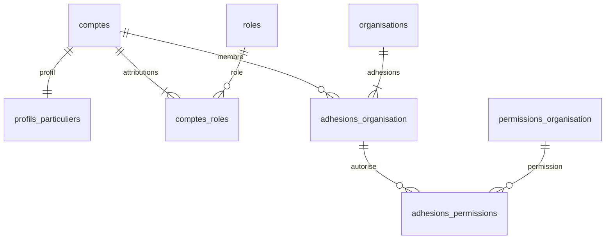
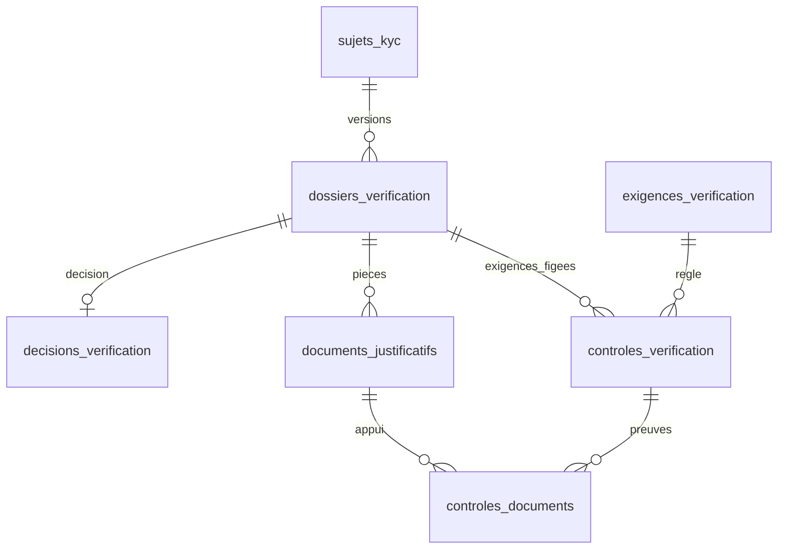
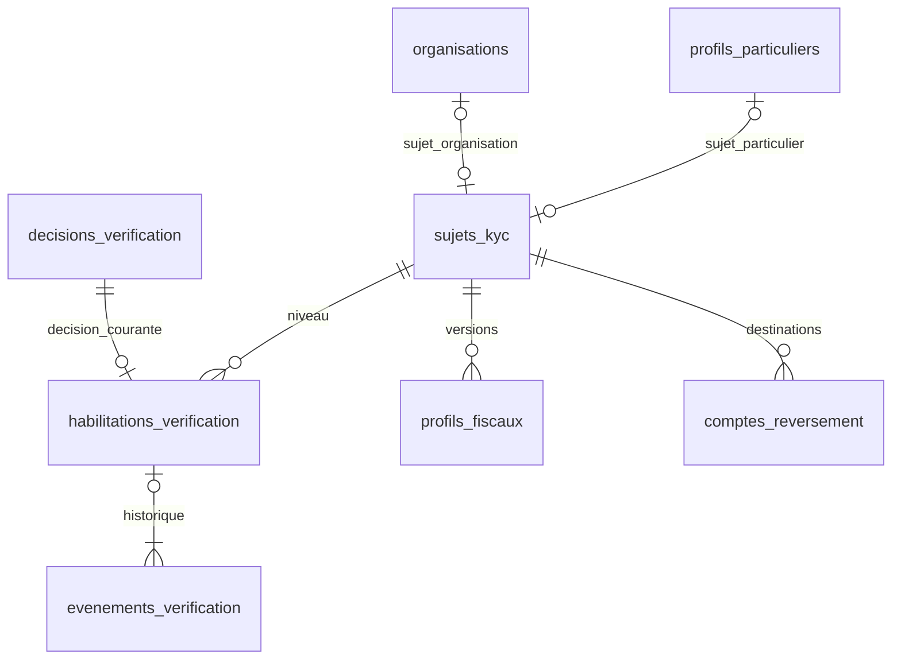

# MLD A1 — Identité et accès — Afrique-Educ

Version 1.3 — 7 septembre 2026 — lot V1 consolidé pour préparation du MPD.

Modèle associé : [MOT_A1_V1_3_Consolide.md](MOT_A1_V1_3_Consolide.md). Contrat normatif commun : [Contrats V1.3](Contrats_inter_chaines_V1_3.md). [Guide du MPD](Guide_MPD_V1_3.md).

Base : fichier A1 du ZIP audité, révisé selon F01–F15 et recommandations approuvées. Provenance et empreintes dans le manifeste. Les compléments de données et procédures V1.3 sont intégrés ci-dessous ; la recette historique est complétée par les scénarios transversaux.

## 1. Conventions et décisions de traduction

Les noms français en snake_case sont logiques ; leur adaptation aux noms Laravel existants se fera au MPD après inspection du dépôt. `ID` est un identifiant opaque homogène (choix entier/UUID et tailles différés). `TEXTE`, `CODE`, `SECRET`, `ENTIER`, `BOOLEEN`, `DATE`, `INSTANT` sont des domaines logiques. Les instants sont comparables sur une référence UTC ; les longueurs, collations et types SQL seront définis au MPD.

`!` = obligatoire, `?` = nullable ; PK = clé primaire ; FK = clé étrangère ; UQ = unicité. Une FK nullable s’applique lorsqu’elle est renseignée. Pour chaque unicité conditionnelle, le MPD doit choisir une réalisation effective et la tester ; elle n’est pas présentée comme une simple contrainte SQL portable. Toutes les références historiques utilisent une politique RESTRICT/NO ACTION par défaut, pas de suppression en cascade des preuves.

Décisions de traduction :

- Conserver le compte personnel avec profil obligatoire et adhésions à des organisations.
- Factoriser le sujet KYC en `sujets_kyc`, avec deux vraies FK exclusives ; éviter une paire polymorphe type/id sans intégrité référentielle.
- Représenter une version de dossier par une ligne. Les exigences sélectionnées sont matérialisées par les contrôles pending, puis figées à la soumission.
- Séparer décision immuable et habilitation courante. Une approbation passée ne suffit pas à autoriser une opération actuelle.
- Normaliser intérêts, permissions, pièces de contrôle et événements de consentement. Ces tables sont des traductions/compléments logiques, pas de nouveaux parcours produit.
- Retenir une persistance dédiée des défis, livraisons et du registre des sessions. Le choix d’un mécanisme de framework reste possible au MPD seulement s’il couvre intégralement ces exigences, sans deux autorités concurrentes de révocation.
- Ne pas ajouter `deleted_at` aux comptes : `closed` ferme l’accès sans masquer les preuves. Aucune durée légale de conservation n’est supposée ici.

## 2. Dictionnaire relationnel

Les listes d’attributs ci-dessous constituent le schéma logique exhaustif de chaque table A1. Les colonnes d’optimisation et timestamps techniques supplémentaires ne sont pas imposés au MLD.

### 2.1. `comptes` — Compte

| Attribut | Domaine | Nullable |
|---|---|---|
| `id` | ID | Non |
| `email_normalise` | TEXTE | Non |
| `telephone_normalise` | TEXTE | Oui |
| `hash_mdp` | SECRET | Non |
| `statut` | CODE | Non |
| `locale` | CODE | Non |
| `email_verifie_a` | INSTANT | Oui |
| `telephone_verifie_a` | INSTANT | Oui |
| `cree_a` | INSTANT | Non |
| `ferme_a` | INSTANT | Oui |

**Clés :** PK(id) ; UQ(email_normalise).

**Règles :** Statut pending/active/suspended/closed. closed implique ferme_a renseigné ; les autres états impliquent ferme_a absent. active exige une preuve e-mail. Pas de deleted_at dans ce MLD. Téléphone facultatif et non unique. L’e-mail reste réservé après clôture ; un changement d’identifiant ou une politique de réutilisation devra faire l’objet d’un traitement dédié.

### 2.2. `profils_particuliers` — ProfilParticulier

| Attribut | Domaine | Nullable |
|---|---|---|
| `compte_id` | ID | Non |
| `prenom` | TEXTE | Non |
| `nom` | TEXTE | Non |
| `nom_plume` | TEXTE | Oui |
| `pays` | CODE | Non |
| `ville` | TEXTE | Oui |
| `langue_ecriture` | CODE | Oui |

**Clés :** PK(compte_id) ; FK(compte_id) → comptes.id.

**Règles :** Clé partagée : au plus un profil par compte. La présence obligatoire du profil est garantie par la transaction de création (une FK seule ne garantit pas le minimum côté compte).

### 2.3. `interets_profils` — Normalisation de centres_interet

| Attribut | Domaine | Nullable |
|---|---|---|
| `compte_id` | ID | Non |
| `libelle_normalise` | TEXTE | Non |

**Clés :** PK(compte_id, libelle_normalise) ; FK(compte_id) → profils_particuliers.compte_id.

**Règles :** Valeurs atomiques, aucune liste CSV dans le profil. Un futur rattachement à la taxonomie A2 remplacera ce vocabulaire libre seulement après décision explicite.

### 2.4. `types_organisation` — TypeOrganisation

| Attribut | Domaine | Nullable |
|---|---|---|
| `id` | ID | Non |
| `code` | CODE | Non |
| `libelle` | TEXTE | Non |

**Clés :** PK(id) ; UQ(code).

**Règles :** Référentiel partagé ; codes issus du MCD, sans dupliquer le type dans organisations.

### 2.5. `organisations` — Organisation

| Attribut | Domaine | Nullable |
|---|---|---|
| `id` | ID | Non |
| `type_organisation_id` | ID | Non |
| `raison_sociale` | TEXTE | Non |
| `email_pro` | TEXTE | Oui |
| `site` | TEXTE | Oui |
| `pays` | CODE | Non |
| `ville` | TEXTE | Oui |
| `statut_operationnel` | CODE | Non |
| `cree_a` | INSTANT | Non |

**Clés :** PK(id) ; FK(type_organisation_id) → types_organisation.id.

**Règles :** active/restricted/closed. La raison sociale n’est pas une clé unique mondiale. Une organisation active doit avoir exactement un principal actif dont le compte est actif.

### 2.6. `adhesions_organisation` — CompteOrganisation

| Attribut | Domaine | Nullable |
|---|---|---|
| `id` | ID | Non |
| `compte_id` | ID | Non |
| `organisation_id` | ID | Non |
| `fonction` | TEXTE | Non |
| `principal` | BOOLEEN | Non |
| `statut` | CODE | Non |
| `origine` | CODE | Non |
| `cree_a` | INSTANT | Non |
| `active_a` | INSTANT | Oui |
| `revoque_a` | INSTANT | Oui |
| `motif` | TEXTE | Oui |

**Clés :** PK(id) ; UQ(compte_id, organisation_id) ; FK(compte_id) → comptes.id ; FK(organisation_id) → organisations.id.

**Règles :** active/suspended/revoked ; invited réservé. Une association historique est conservée, les changements sont journalisés. Unicité conditionnelle du principal actif par organisation : voir R03. principal peut rester historique sur une adhésion révoquée.

### 2.7. `permissions_organisation` — Référentiel des permissions métier

| Attribut | Domaine | Nullable |
|---|---|---|
| `id` | ID | Non |
| `code` | CODE | Non |
| `libelle` | TEXTE | Non |

**Clés :** PK(id) ; UQ(code).

**Règles :** Par exemple deposer_kyc, deposer_publication, publier_offre, demander_reversement. Un code donne une capacité dans un contexte, sans contourner KYC ou statut du compte.

### 2.8. `adhesions_permissions` — Normalisation de permissions_metier

| Attribut | Domaine | Nullable |
|---|---|---|
| `adhesion_id` | ID | Non |
| `permission_id` | ID | Non |

**Clés :** PK(adhesion_id, permission_id) ; FK(adhesion_id) → adhesions_organisation.id ; FK(permission_id) → permissions_organisation.id.

**Règles :** Attributions courantes ; ajout/retrait accompagné d’un événement immuable. Pas de permissions stockées en chaîne ou liste opaque.

### 2.9. `roles` — Role

| Attribut | Domaine | Nullable |
|---|---|---|
| `id` | ID | Non |
| `code` | CODE | Non |
| `libelle` | TEXTE | Non |

**Clés :** PK(id) ; UQ(code).

**Règles :** reader, author, publisher, moderator, support, admin. Les rôles privilégiés ne proviennent jamais de l’inscription publique ou du KYC.

### 2.10. `comptes_roles` — CompteRole

| Attribut | Domaine | Nullable |
|---|---|---|
| `id` | ID | Non |
| `compte_id` | ID | Non |
| `role_id` | ID | Non |
| `statut` | CODE | Non |
| `origine` | CODE | Non |
| `attribue_a` | INSTANT | Non |
| `revoque_a` | INSTANT | Oui |
| `motif` | TEXTE | Oui |
| `attribue_par` | ID | Oui |

**Clés :** PK(id) ; UQ(compte_id, role_id) ; FK(compte_id) → comptes.id ; FK(role_id) → roles.id ; FK(attribue_par) → comptes.id.

**Règles :** active/revoked. reader créé atomiquement avec le compte. attribue_par absent seulement pour attribution système dont origine explicite. Une réattribution modifie la ligne et ajoute un événement, sans doublon.

### 2.11. `evenements_compte` — EvenementCompte

| Attribut | Domaine | Nullable |
|---|---|---|
| `id` | ID | Non |
| `compte_sujet_id` | ID | Non |
| `adhesion_id` | ID | Oui |
| `compte_role_id` | ID | Oui |
| `permission_id` | ID | Oui |
| `attribution_interne_id` | ID | Oui |
| `type` | CODE | Non |
| `date` | INSTANT | Non |
| `ancien_etat` | TEXTE | Oui |
| `nouvel_etat` | TEXTE | Oui |
| `motif` | TEXTE | Non |
| `auteur_compte_id` | ID | Oui |
| `origine_systeme` | CODE | Oui |
| `fin_prevue` | INSTANT | Oui |
| `correlation` | TEXTE | Non |

**Clés :** PK(id) ; FK(compte_sujet_id) → comptes.id ; FK(adhesion_id) → adhesions_organisation.id ; FK(compte_role_id) → comptes_roles.id ; FK(permission_id) → permissions_organisation.id ; FK(auteur_compte_id) → comptes.id ; FK(attribution_interne_id) → attributions_internes.id.

**Règles :** Append-only. XOR auteur_compte_id/origine_systeme. L’adhésion ou attribution visée appartient au compte sujet ; permission_id exige adhesion_id. Aucun secret dans ancien/nouvel état. Un transfert de principal produit des événements pour les deux comptes sous la même corrélation.

### 2.12. `adresses` — Adresse

| Attribut | Domaine | Nullable |
|---|---|---|
| `id` | ID | Non |
| `compte_id` | ID | Non |
| `libelle` | TEXTE | Oui |
| `ligne1` | TEXTE | Non |
| `ligne2` | TEXTE | Oui |
| `ville` | TEXTE | Non |
| `region` | TEXTE | Oui |
| `cp` | TEXTE | Oui |
| `pays` | CODE | Non |
| `telephone` | TEXTE | Oui |
| `defaut` | BOOLEEN | Non |

**Clés :** PK(id) ; FK(compte_id) → comptes.id.

**Règles :** Au plus une adresse par défaut par compte, sous verrou du compte. Les commandes conservent leurs propres snapshots et ne dépendent pas d’une adresse mutable pour leur preuve historique.

### 2.13. `textes_legaux_versions` — TexteLegalVersion

| Attribut | Domaine | Nullable |
|---|---|---|
| `id` | ID | Non |
| `type` | CODE | Non |
| `version` | TEXTE | Non |
| `langue` | CODE | Non |
| `contenu` | TEXTE | Oui |
| `reference_immuable` | TEXTE | Oui |
| `empreinte` | TEXTE | Non |
| `publie_a` | INSTANT | Non |
| `requis_pour_activation` | BOOLEEN | Non |

**Clés :** PK(id) ; UQ(type, version, langue).

**Règles :** XOR contenu/reference_immuable. Publication immuable. Une nouvelle politique crée une version. La sélection des versions applicables se fait par type/langue et date de publication, pas en exigeant toutes les versions historiques.

### 2.14. `consentements` — Consentement

| Attribut | Domaine | Nullable |
|---|---|---|
| `id` | ID | Non |
| `compte_id` | ID | Non |
| `texte_version_id` | ID | Non |
| `nature` | CODE | Non |
| `accepte_a` | INSTANT | Non |
| `retire_a` | INSTANT | Oui |
| `source` | CODE | Non |
| `canal` | CODE | Non |

**Clés :** PK(id) ; UQ(compte_id, texte_version_id) ; FK(compte_id) → comptes.id ; FK(texte_version_id) → textes_legaux_versions.id.

**Règles :** acceptation/prise_connaissance/consentement_optionnel. retire_a >= accepte_a si présent. La preuve initiale est conservée ; un retrait optionnel ne clôture pas le compte.

### 2.15. `evenements_consentement` — Complément logique pour retraits et nouveaux accords

| Attribut | Domaine | Nullable |
|---|---|---|
| `id` | ID | Non |
| `consentement_id` | ID | Non |
| `type` | CODE | Non |
| `date` | INSTANT | Non |
| `source` | CODE | Non |
| `canal` | CODE | Non |

**Clés :** PK(id) ; FK(consentement_id) → consentements.id.

**Règles :** acceptation/retrait/reacceptation. Journal append-only pour conserver un nouvel accord sur la même version sans violer l’unicité du MCD ; retire_a est la projection courante du dernier retrait non suivi d’un nouvel accord.

### 2.16. `sujets_kyc` — Factorisation du sujet XOR

| Attribut | Domaine | Nullable |
|---|---|---|
| `id` | ID | Non |
| `profil_compte_id` | ID | Oui |
| `organisation_id` | ID | Oui |

**Clés :** PK(id) ; UQ(profil_compte_id lorsque non NULL) ; UQ(organisation_id lorsque non NULL) ; FK(profil_compte_id) → profils_particuliers.compte_id ; FK(organisation_id) → organisations.id.

**Règles :** CHECK exactement un des deux champs renseigné. Cette table technique relationnelle remplace la répétition du XOR dans cinq tables. Un sujet créé à la première demande KYC ; il n’est pas une troisième catégorie de personne.

### 2.17. `exigences_verification` — ExigenceVerification

| Attribut | Domaine | Nullable |
|---|---|---|
| `id` | ID | Non |
| `code` | CODE | Non |
| `version_regles` | TEXTE | Non |
| `type_sujet` | CODE | Non |
| `type_organisation_id` | ID | Oui |
| `pays` | CODE | Non |
| `niveau` | CODE | Non |
| `volet` | CODE | Non |
| `nature_preuve` | TEXTE | Non |
| `obligatoire` | BOOLEEN | Non |
| `autorise_non_applicable` | BOOLEEN | Non |
| `date_effet` | INSTANT | Non |

**Clés :** PK(id) ; UQ(code, version_regles) ; FK(type_organisation_id) → types_organisation.id.

**Règles :** code identifie une exigence et son périmètre, version_regles sa révision. particulier/organisation ; type organisation absent pour particulier. Référentiel immuable après utilisation. Les niveaux et volets sont les codes du MCD ; aucune exigence légale locale n’est inventée.

### 2.18. `profils_fiscaux` — ProfilFiscal versionné

| Attribut | Domaine | Nullable |
|---|---|---|
| `id` | ID | Non |
| `sujet_id` | ID | Non |
| `version` | ENTIER | Non |
| `identifiant_fiscal` | TEXTE | Oui |
| `pays_fiscal` | CODE | Non |
| `nom_legal` | TEXTE | Non |
| `statut_controle` | CODE | Non |
| `reference_privee` | TEXTE | Oui |

**Clés :** PK(id) ; UQ(sujet_id, version) ; UQ(id, sujet_id) ; FK(sujet_id) → sujets_kyc.id.

**Règles :** Version positive ; pending/verified/rejected. Données figées dès soumission d’un dossier ; correction par nouvelle version. Un état verified ne remplace jamais l’habilitation commerciale.

### 2.19. `comptes_reversement` — CompteReversement versionné

| Attribut | Domaine | Nullable |
|---|---|---|
| `id` | ID | Non |
| `sujet_id` | ID | Non |
| `version` | ENTIER | Non |
| `canal` | CODE | Non |
| `prestataire` | TEXTE | Oui |
| `titulaire` | TEXTE | Non |
| `pays` | CODE | Non |
| `devise` | CODE | Non |
| `reference_prestataire` | TEXTE | Oui |
| `coordonnees_chiffrees` | SECRET | Oui |
| `affichage_masque` | TEXTE | Non |
| `statut_controle` | CODE | Non |
| `verifie_a` | INSTANT | Oui |

**Clés :** PK(id) ; UQ(sujet_id, version) ; UQ(id, sujet_id) ; FK(sujet_id) → sujets_kyc.id.

**Règles :** Version positive ; XOR référence prestataire/coordonnées chiffrées ; pending/verified/rejected. Choix de numérotation : suite par sujet couvrant toutes les destinations historiques. Pas de secret de carte. Nouvelle destination/version contrôlée avant sélection par le commerce.

### 2.20. `dossiers_verification` — DossierVerification, une ligne par version

| Attribut | Domaine | Nullable |
|---|---|---|
| `id` | ID | Non |
| `sujet_id` | ID | Non |
| `numero` | TEXTE | Non |
| `version` | ENTIER | Non |
| `precedent_id` | ID | Oui |
| `niveau` | CODE | Non |
| `statut` | CODE | Non |
| `deposant_id` | ID | Non |
| `profil_fiscal_id` | ID | Oui |
| `compte_reversement_id` | ID | Oui |
| `cree_a` | INSTANT | Non |
| `soumis_a` | INSTANT | Oui |
| `clos_a` | INSTANT | Oui |

**Clés :** PK(id) ; UQ(numero, version) ; UQ(precedent_id lorsque non NULL) ; UQ(id, sujet_id) ; UQ(id, sujet_id, niveau) ; FK(sujet_id) → sujets_kyc.id ; FK(precedent_id) → dossiers_verification.id ; FK(deposant_id) → comptes.id ; FK(profil_fiscal_id, sujet_id) → profils_fiscaux(id, sujet_id) ; FK(compte_reversement_id, sujet_id) → comptes_reversement(id, sujet_id).

**Règles :** draft/submitted/under_review/needs_fix/approved/rejected/expired. numero est stable dans une lignée ; première version=1, sinon précédent même sujet/niveau/numéro et version+1. Un nouveau cycle de renouvellement peut avoir un nouveau numero. Aucun embranchement. organisation_verifiee exige un sujet organisation. Unicité des dossiers en cours, voir R05. Chaque dossier fige aussi la preuve d’identité à la soumission : pièces et instantanés privés des informations évaluées, conservés par reference_privee des documents, sans relire un profil mutable pour reconstituer la décision.

### 2.21. `documents_justificatifs` — DocumentJustificatif

| Attribut | Domaine | Nullable |
|---|---|---|
| `id` | ID | Non |
| `dossier_id` | ID | Non |
| `deposant_id` | ID | Non |
| `type_doc` | CODE | Non |
| `reference_privee` | TEXTE | Non |
| `empreinte` | TEXTE | Non |
| `numero` | TEXTE | Oui |
| `autorite` | TEXTE | Oui |
| `delivre_le` | DATE | Oui |
| `expire_le` | DATE | Oui |
| `depose_a` | INSTANT | Non |
| `statut_verification` | CODE | Non |
| `motif_rejet` | TEXTE | Oui |

**Clés :** PK(id) ; UQ(id, dossier_id) ; FK(dossier_id) → dossiers_verification.id ; FK(deposant_id) → comptes.id.

**Règles :** pending/accepted/rejected. Objet privé ; dates cohérentes. Contenu et métadonnées soumis immuables ; résultats de contrôle traçables. Une nouvelle version du dossier crée de nouvelles lignes de pièce, pouvant référencer le même objet immuable si inchangé.

### 2.22. `controles_verification` — ControleVerification et liste des exigences figées

| Attribut | Domaine | Nullable |
|---|---|---|
| `id` | ID | Non |
| `dossier_id` | ID | Non |
| `exigence_id` | ID | Non |
| `resultat` | CODE | Non |
| `observation` | TEXTE | Oui |
| `controle_a` | INSTANT | Oui |
| `justification_non_applicable` | TEXTE | Oui |
| `controleur_id` | ID | Oui |
| `origine_systeme` | CODE | Oui |

**Clés :** PK(id) ; UQ(dossier_id, exigence_id) ; UQ(id, dossier_id) ; FK(dossier_id) → dossiers_verification.id ; FK(exigence_id) → exigences_verification.id ; FK(controleur_id) → comptes.id.

**Règles :** Un contrôle pending créé pour chaque exigence sélectionnée à la soumission : l’ensemble des lignes fige la matrice applicable. passed/failed/not_applicable exigent date et auteur ou origine système en XOR. pending peut être sans auteur. not_applicable exige justification et exigence l’autorisant. Réévaluation journalisée avant clôture ; pas d’écrasement après décision terminale.

### 2.23. `controles_documents` — Association N–N contrôle/pièce

| Attribut | Domaine | Nullable |
|---|---|---|
| `controle_id` | ID | Non |
| `document_id` | ID | Non |
| `dossier_id` | ID | Non |

**Clés :** PK(controle_id, document_id) ; FK(controle_id, dossier_id) → controles_verification(id, dossier_id) ; FK(document_id, dossier_id) → documents_justificatifs(id, dossier_id).

**Règles :** dossier_id est une redondance contrôlée par les deux FK composites : une pièce d’un autre dossier ne peut être utilisée silencieusement. Un contrôle de canal peut n’avoir aucune pièce ; la preuve figure alors dans observation et journal.

### 2.24. `decisions_verification` — DecisionVerification

| Attribut | Domaine | Nullable |
|---|---|---|
| `id` | ID | Non |
| `dossier_id` | ID | Non |
| `decideur_id` | ID | Non |
| `resultat` | CODE | Non |
| `motif` | TEXTE | Non |
| `decide_a` | INSTANT | Non |
| `valide_jusqua` | INSTANT | Oui |
| `restrictions` | TEXTE | Oui |

**Clés :** PK(id) ; UQ(dossier_id) ; UQ(id, dossier_id) ; FK(dossier_id) → dossiers_verification.id ; FK(decideur_id) → comptes.id.

**Règles :** approved/needs_fix/rejected. Une décision terminale par version. Aucun amendement en place ; nouvelle version si réexamen. Date de validité postérieure à la décision si renseignée. Approbation nécessite contrôles requis satisfaits ; absence d’auto-approbation du déposant ou représentant du sujet.

### 2.25. `habilitations_verification` — HabilitationVerification courante

| Attribut | Domaine | Nullable |
|---|---|---|
| `id` | ID | Non |
| `sujet_id` | ID | Non |
| `niveau` | CODE | Non |
| `dossier_courant_id` | ID | Non |
| `decision_courante_id` | ID | Non |
| `etat` | CODE | Non |
| `obtenue_a` | INSTANT | Non |
| `valide_jusqua` | INSTANT | Oui |
| `motif_restriction` | TEXTE | Oui |

**Clés :** PK(id) ; UQ(sujet_id, niveau) ; UQ(decision_courante_id) ; FK(sujet_id) → sujets_kyc.id ; FK(dossier_courant_id, sujet_id, niveau) → dossiers_verification(id, sujet_id, niveau) ; FK(decision_courante_id, dossier_courant_id) → decisions_verification(id, dossier_id).

**Règles :** valid/a_renouveler/restreint/expired/revoked. Créée uniquement après approved. La décision courante doit être approved ; ce prédicat exige validation transactionnelle. obtenue_a conserve première acquisition ; échéance courante issue de la décision. Historique des références antérieures conservé dans événements. Échéance dépassée bloque accès même si le traitement planifié n’a pas encore changé etat.

### 2.26. `evenements_verification` — EvenementVerification

| Attribut | Domaine | Nullable |
|---|---|---|
| `id` | ID | Non |
| `dossier_id` | ID | Oui |
| `habilitation_id` | ID | Oui |
| `controle_id` | ID | Oui |
| `decision_id` | ID | Oui |
| `type` | CODE | Non |
| `date` | INSTANT | Non |
| `ancien_etat` | TEXTE | Oui |
| `nouvel_etat` | TEXTE | Oui |
| `motif` | TEXTE | Non |
| `auteur_compte_id` | ID | Oui |
| `origine_systeme` | CODE | Oui |
| `correlation` | TEXTE | Non |

**Clés :** PK(id) ; FK(dossier_id) → dossiers_verification.id ; FK(habilitation_id) → habilitations_verification.id ; FK(controle_id) → controles_verification.id ; FK(decision_id) → decisions_verification.id ; FK(auteur_compte_id) → comptes.id.

**Règles :** Au moins dossier_id ou habilitation_id ; les deux lors d’une décision d’habilitation. XOR acteur/origine système. Références et sujets concordants contrôlés dans la transaction. decision_id conserve la décision concernée même après renouvellement. Contrôle modifié : ancien/nouveau résultat journalisé. Append-only.

### 2.27. `defis_verification` — DefiVerification, persistance logique dédiée

| Attribut | Domaine | Nullable |
|---|---|---|
| `id` | ID | Non |
| `compte_id` | ID | Non |
| `finalite` | CODE | Non |
| `canal` | CODE | Non |
| `destination_chiffree` | SECRET | Non |
| `empreinte_destination` | TEXTE | Non |
| `destination_masquee` | TEXTE | Non |
| `empreinte_secret` | SECRET | Non |
| `cree_a` | INSTANT | Non |
| `expire_a` | INSTANT | Non |
| `consomme_a` | INSTANT | Oui |
| `revoque_a` | INSTANT | Oui |
| `nombre_essais` | ENTIER | Non |
| `plafond_essais` | ENTIER | Non |

**Clés :** PK(id) ; FK(compte_id) → comptes.id.

**Règles :** email_activation/password_reset/phone_verification. Expiration > création, essais >=0 et plafond >0, consommé et révoqué mutuellement exclusifs. Au plus un défi ouvert par compte/finalité : émission sous verrou du compte révoque les précédents non consommés. Destination liée à l’identifiant courant ; aucun secret brut persistant. Exception de représentation nécessaire aux reprises : le message exact est conservé temporairement et chiffré dans transmissions_messages, selon §10.3 ; seule l’empreinte reste dans le défi.

### 2.28. `envois_defis` — Vue de compatibilité, non persistée

Les essais d’envoi de défis utilisent maintenant `messages_sortants`, `transmissions_messages` et `tentatives_transmission` (§10.1). `envois_defis` est une vue logique de consultation filtrant messages_sortants.defi_id non nul : defi_id, transmission_id, numero_essai (= tentatives.numero), resultat, demande_a (= commence_a), termine_a, reference_envoi et code_erreur. La clé logique d’un essai est (transmission_id, numero_essai). Il n’existe plus de table d’essais concurrente.

### 2.29. `sessions_authentification` — SessionAuthentification, registre d’accès

| Attribut | Domaine | Nullable |
|---|---|---|
| `id` | ID | Non |
| `compte_id` | ID | Non |
| `empreinte_reference` | SECRET | Non |
| `portee` | CODE | Non |
| `statut` | CODE | Non |
| `ouverte_a` | INSTANT | Non |
| `derniere_activite_a` | INSTANT | Non |
| `expire_absolue_a` | INSTANT | Non |
| `expire_inactivite_a` | INSTANT | Non |
| `revoque_a` | INSTANT | Oui |
| `motif_revocation` | TEXTE | Oui |
| `contexte_client` | TEXTE | Oui |
| `demande_support_id` | ID | Oui |
| `autorise_par` | ID | Oui |
| `config_acces_id` | ID | Non |

**Clés :** PK(id) ; UQ(empreinte_reference) ; FK(compte_id) → comptes.id ; FK(demande_support_id) → demandes_support.id ; FK(autorise_par) → comptes.id ; FK(config_acces_id) → configurations_service.id.

**Règles :** limited/normal/support_only ; active/expired/revoked. Référence cliente opaque, seule empreinte persistée. Normal exige compte active à chaque requête ; support_only permet uniquement le périmètre de recours vérifié. Délais évalués à la lecture, pas seulement par tâche planifiée. Le registre ne crée aucune licence et n’enregistre pas les appareils de lecture A4.

Pour support_only, demande_support_id et autorise_par sont obligatoires : demande du même titulaire, identité vérifiée et permission autoriser_recours vérifiée à la création. Pour les autres portées ces champs sont absents. config_acces_id fige la version A1_acces applicable à l’émission ; une révocation/mesure de sécurité reste prioritaire sur cette version.

## 3. Invariants nécessitant une transaction

Les FK/UQ garantissent existence et unicité ; elles ne garantissent pas à elles seules les minima de cardinalité, l’immutabilité, les permissions ou une condition portant sur plusieurs lignes. Les opérations ci-dessous doivent être atomiques et passer par les mêmes services, y compris les actions d’administration.

| Réf. | Invariant | Garantie attendue |
|---|---|---|
| R01 | Un compte possède profil, reader et événement initial | Créer les quatre éléments dans la même transaction ; retour arrière complet en cas d’échec. PK partagée interdit deux profils. Aucun chemin d’écriture créant un compte orphelin. |
| R02 | Unicité de l’identité | UQ e-mail normalisé, traitement explicite du conflit concurrent ; ne pas déduire une identité d’un téléphone partagé ou d’un nom. |
| R03 | Principal unique et présent si organisation opérationnelle | Verrouiller la ligne organisation ; contrôler compte et adhésion actifs ; retirer ancien principal et installer nouveau dans la même transaction. Contrainte d’unicité conditionnelle à matérialiser au MPD pour le maximum. Le minimum est transactionnel. Toute suspension du principal restreint les actions jusqu’au transfert. |
| R04 | Autorisation courante | Compte, session, rôle, adhésion et permission contrôlés à chaque action ; état KYC et échéance aussi pour action commerciale. Rôle publisher seul insuffisant. |
| R05 | Un dossier en cours par sujet/niveau | États en cours = draft, submitted, under_review. Verrouiller sujets_kyc lors de création d’une version ; vérifier aucun autre dossier en cours. UQ conditionnelle à implémenter au MPD ; ne pas compter approved/needs_fix/rejected/expired comme en cours. |
| R06 | Chaîne des versions | Verrouiller sujet et précédent ; même sujet/niveau/numéro, version précédente+1 ; précédent non en cours ; une seule version suivante. Le numéro de nouvelle lignée est généré sans collision, sans réemploi par un autre sujet/niveau. |
| R07 | Soumission immuable et complète | Sélectionner exigences en vigueur, créer contrôles pending, lier pièces et versions commerciales du même sujet puis figer contenu et références. Les résultats de contrôle peuvent évoluer jusqu’à décision, pas les preuves soumises. |
| R08 | Décision terminale unique | Verrou dossier ; vérifier habilitation du décideur, absence d’auto-approbation et contrôles complets ; insérer décision (UQ dossier), changer statut, écrire événements et habilitation dans une transaction. |
| R09 | Habilitation cohérente | FK composites garantissent sujet/niveau/dossier ; service garantit décision approved et préconditions du niveau. Modification de la référence courante accompagnée d’un événement contenant la décision concernée. |
| R10 | Données commerciales concordantes | Les FK composites empêchent dossier fiscal/reversement d’un autre sujet. Les valeurs soumises et versions vérifiées ne sont pas remplacées en place. Changement sensible : restriction puis nouveau contrôle. |
| R11 | Défi consommé une seule fois | Verrou compte puis défi ; recontrôler finalité, empreinte, destination, échéance et essais ; consommation et activation/reset dans une transaction. Une validation préalable n’autorise pas une consommation ultérieure sans recontrôle. |
| R12 | Révocation globale fiable | Login, reset, suspension et clôture synchronisés sur le compte ; reset change empreinte du mot de passe, révoque sessions et autres défis puis journalise. Statut suspended/closed inchangé après reset. |
| R13 | Session limitée | Un compte pending n’accède qu’aux fonctions limited. Après suspension, toute session normale est révoquée ; un circuit vérifié peut créer une NOUVELLE support_only sans pouvoir publier/payer/lire. |
| R14 | Préservation des historiques | Décisions, textes publiés et événements append-only ; accès d’écriture restreint ; toute purge future soumise à une politique définie séparément, pas à la clôture du compte. |
| R15 | Références d’événements | Vérifier compte des adhésions/rôles, sujet/niveau des références KYC et dossier du contrôle/de la décision. Événement d’habilitation possède dossier et habilitation ; aucune référence à un autre sujet. |

**Ordre des verrous.** Après prise des barrières CT-03, ordre local : comptes concernés triés, organisations concernées triées, sujets KYC, dossiers, défis/sessions. Les opérations multi-acteurs utilisent le même ordre et relisent les préconditions après verrouillage. Une tâche d’expiration ne peut accorder un droit ; le contrôle d’accès compare toujours l’heure courante aux échéances.

**Limite de l’approche.** Les minima « au moins un événement », « au moins une adhésion historique » et « un profil obligatoire » sont assurés par les services transactionnels. S’il existe des écritures directes hors application, le MPD devra ajouter une protection équivalente ou les interdire.

## 4. Interfaces avec les autres domaines

### 4.1 Auteur — interface catalogue A2/publication A5

Contrat partagé A2 : AUTEUR possède auteur_id et compte_id nullable, FK vers comptes.id et UQ sur les valeurs non nulles. Un compte peut être lié à zéro ou une fiche ; une fiche peut exister sans compte. Conserver les champs A2 et son statut_publication draft/published/archived. Le compte/rôle author ne prouve pas la propriété d’une fiche déjà publiée. Le MLD A1 n’impose ni renommage ni recréation des tables du lot catalogue.

### 4.2 Vendeur — interface marketplace

Relation commerciale partagée, définie ici et réutilisée par A2/A3/A5/A6, une seule fois au MPD :

```text
vendeurs(
  id ID PK;
  sujet_id ID FK sujets_kyc.id;
  profil_fiscal_id ID? FK profils_fiscaux.id;
  compte_reversement_id ID? FK comptes_reversement.id;
  serie_facturation TEXTE?;
  actif BOOLEEN
)
FK(profil_fiscal_id, sujet_id) -> profils_fiscaux(id, sujet_id)
FK(compte_reversement_id, sujet_id) -> comptes_reversement(id, sujet_id)
```

Chaque vendeur référence exactement un sujet KYC. serie_facturation peut être absente en préparation ; un circuit d’émission utilisant cette série exige sa valeur validée avant émission. actif initialement faux ; activation exige les préconditions commerciales. Il n’y a pas d’UQ(sujet_id) sur vendeurs : le MCD autorise plusieurs vendeurs par sujet, et cet arbitrage appartient au commerce. Chaque opération recherche l’habilitation de ce même sujet au niveau partenaire_commercial, exige valid et une échéance non dépassée ; pour une organisation, organisation_verifiee doit également être valide. Les versions fiscales et de reversement sélectionnées doivent être celles du dossier approuvé courant (ou d’une validation ultérieure explicitement adoptée). Des références non nulles ne prouvent pas cette validation.

### 4.3 Achat, lecture et support

Paiement : compte active + session normal valide. Les tables commerce ne reçoivent pas une copie de cet état pour autoriser durablement une commande. Lecture : SessionLecture et JetonAcces restent en A4 ; une session d’authentification ne tient pas lieu de licence. Suspension/clôture refuse immédiatement les nouveaux accès, puis ferme les sessions de lecture et révoque leurs jetons via interface A4 ; les licences acquises ne sont pas détruites pour cette seule raison. Le suivi durable de livraison et de reprise est défini au §10.1–10.3 ; le transport concret et les transactions des consommateurs seront réalisés au MPD/architecture applicative.

## 5. Diagrammes relationnels de lecture

Les diagrammes sont des vues partielles ; le dictionnaire et les invariants priment pour les contraintes conditionnelles.







Le sujet possède exactement une des deux références particulier/organisation (XOR), que le dessin seul n’exprime pas.

## 6. Index de consultation à prévoir au MPD

Les PK/UQ et FK sont déjà définies ; les index ci-dessous servent les recherches concrètes. Éviter les doublons avec les index déjà créés pour les contraintes.

| Recherche | Clé de recherche proposée |
|---|---|
| Organisations accessibles à une personne | adhesions_organisation(compte_id, statut) |
| Principal/membres d’une organisation | adhesions_organisation(organisation_id, statut, principal) |
| Historique compte ou corrélation | evenements_compte(compte_sujet_id, date, id), puis correlation |
| Historique KYC par niveau | dossiers_verification(sujet_id, niveau, cree_a, id) |
| File de dossiers à contrôler | dossiers_verification(statut, soumis_a, id) |
| Habilitations arrivant à échéance | habilitations_verification(etat, valide_jusqua) |
| Événements dossier/habilitation | evenements_verification(dossier_id, date, id), (habilitation_id, date, id) |
| Défis ouverts d’un compte | defis_verification(compte_id, finalite, expire_a) |
| Sessions à révoquer | sessions_authentification(compte_id, statut) |
| Nettoyage technique après politique de conservation | défis expire_a, sessions expire_absolue_a ; pas de purge des preuves KYC implicite |

## 7. Ordre de réalisation et correspondance au MCD

| Lot logique | Relations principales | Concepts couverts |
|---|---|---|
| Identité | comptes, profils, intérêts, types, organisations | Compte, ProfilParticulier, TypeOrganisation, Organisation |
| Autorisations | rôles, attributions, adhésions, permissions, événements compte | Role, CompteRole, CompteOrganisation, EvenementCompte |
| Informations et preuves de textes | adresses, textes, consentements et leurs événements | Adresse, TexteLegalVersion, Consentement |
| Sujets et données commerciales | sujets_kyc, profils_fiscaux, comptes_reversement | XOR du sujet, ProfilFiscal, CompteReversement |
| KYC | exigences, dossiers, pièces, contrôles, lien contrôle/pièce, décisions, habilitations, événements | Ensemble du §2.1.2 MCD |
| Accès | défis, messages/transmissions/tentatives, sessions | Objets logiques du §2.1.3 MCD |
| Intégrations | FK compte sur auteur ; FK sujet sur vendeur | Interfaces A2/A3/A5, à intégrer sans remplacer le lot existant |

Créer d’abord les référentiels et comptes, puis les associations et preuves. Les données commerciales précèdent les dossiers ; les dossiers précèdent pièces/contrôles/décisions ; les décisions précèdent habilitations puis événements KYC. Les FK vers comptes pour les auteurs de décisions ne créent aucune boucle obligatoire à l’insertion. L’application crée compte, profil, reader et événements dans une transaction une fois toutes les tables présentes.

Compatibilité Laravel : choisir au MPD si `comptes` correspond à la table utilisateurs existante et si le gestionnaire de rôles déjà adopté peut porter les attributions et leur historique. Ne pas créer en parallèle deux tables utilisateurs, deux référentiels de rôles ou deux registres de session faisant autorité. Aucune compatibilité avec un schéma installé non fourni n’est présumée.

## 8. Vérifications à exécuter avec le futur MPD

- [ ] Refuser deux profils d’un même compte ; création de compte entièrement annulée si profil ou rôle échoue.
- [ ] Deux transferts concurrents ne laissent ni deux principaux actifs ni une organisation opérationnelle sans principal.
- [ ] Refuser un sujet KYC avec zéro ou deux types, et deux sujets pour la même organisation/personne.
- [ ] Deux dépôts concurrents du même niveau ne créent pas deux dossiers en cours ; un historique approved n’empêche pas un renouvellement.
- [ ] Refuser une pièce appartenant à un autre dossier dans controles_documents.
- [ ] Refuser dossier fiscal/destination d’un autre sujet par FK composites.
- [ ] Refuser habilitation liée à une décision d’un autre niveau/sujet ou à une décision rejected.
- [ ] Une version soumise et sa décision restent consultables après correction/renouvellement.
- [ ] Deux consommations simultanées d’un défi donnent une seule activation/réinitialisation.
- [ ] Reset et suspension invalident toutes les anciennes sessions ; un compte fermé ne se réactive pas par récupération.
- [ ] Une expiration KYC/session bloque l’accès même sans exécution du traitement planifié.
- [ ] Un retrait puis nouvel accord sur la même version conserve les deux événements et une seule ligne de consentement.
- [ ] Clôture n’efface ni profil historique, ni adhésions, ni dossiers, ni relations commandes/licences.

## 9. État du livrable et limites de verrouillage

Le schéma A1 est défini au niveau logique. Les ajouts de factorisation, associations et historiques sont explicités ; les invariants relevant du service transactionnel sont distingués des contraintes structurelles. Le dictionnaire a été contrôlé pour la cohérence des références, attributs et clés ; aucune base n’a été migrée ni testée.

Avant MPD : fixer SGBD/version, convention d’identifiants, longueurs/collations, réalisation des unicités conditionnelles, politiques de secrets et conservation, durées/quota d’accès et matrice documentaire locale. Le MOT V1.1 précise responsabilités, délais proposés et procédures humaines, avec références aux relations du présent MLD. Les interfaces Auteur/Vendeur seront confrontées aux audits A2 et commerce avant leur verrouillage global ; elles n’empêchent pas la préparation du socle A1.

## 10. Alignement organisationnel MLD–MOT V1.1

Cette section intègre les besoins du MOT §7 et précise leurs supports persistants. Les 29 tables initialement décrites deviennent 28 tables persistantes de socle et une vue envois_defis ; 13 relations sont ajoutées, soit **44 tables logiques persistantes (41 du socle et 3 compléments §11), une vue de compatibilité et le contrat vendeur commerce partagé**. Le nombre physique pourra être adapté aux mécanismes déjà présents dans le projet, en conservant les contrats.

### 10.1 Dictionnaire des compléments

Les domaines et notations sont ceux du §1. Les nouvelles références sont réciproques avec le MOT §7 et la matrice §10.6. Les champs DOCUMENT_STRUCTURE ont un schéma versionné explicite au MPD ; ils ne remplacent ni les FK du sujet/dossier, ni les permissions relationnelles.

#### 10.1.1. `permissions_internes` — Catalogue des capacités du back-office

| Attribut | Domaine | Nullable |
|---|---|---|
| `id` | ID | Non |
| `code` | CODE | Non |
| `libelle` | TEXTE | Non |

**Clés :** PK(id) ; UQ(code).

**Règles :** Référentiel distinct des permissions d’organisation : contrôler KYC, décider commerce, transférer, suspendre, réactiver, clôturer, autoriser recours, gérer habilitations internes, configurer et reprendre messages. Aucun privilège accordé automatiquement du seul fait du rôle support/admin.

#### 10.1.2. `attributions_internes` — Permissions explicites, datées, par agent

| Attribut | Domaine | Nullable |
|---|---|---|
| `id` | ID | Non |
| `compte_id` | ID | Non |
| `permission_id` | ID | Non |
| `attribue_par` | ID | Non |
| `attribue_a` | INSTANT | Non |
| `expire_a` | INSTANT | Oui |
| `revoque_a` | INSTANT | Oui |
| `motif` | TEXTE | Non |

**Clés :** PK(id) ; FK(compte_id) → comptes.id ; FK(permission_id) → permissions_internes.id ; FK(attribue_par) → comptes.id.

**Règles :** Une ligne par période ; au plus une attribution non révoquée et non expirée pour compte/permission, contrôlée sous verrou compte. Une nouvelle période ne remplace pas la précédente. Chaque action contrôle compte actif et attribution courante. Attribution et révocation sont journalisées dans evenements_compte avec référence de période ; l’attribuant doit avoir gerer_habilitations_internes. Amorçage initial hors parcours public, par procédure de déploiement tracée ; aucune auto-promotion via formulaire.

#### 10.1.3. `configurations_service` — Politique versionnée d’organisation et de délais

| Attribut | Domaine | Nullable |
|---|---|---|
| `id` | ID | Non |
| `code` | CODE | Non |
| `version` | ENTIER | Non |
| `schema_version` | ENTIER | Non |
| `valeurs` | DOCUMENT_STRUCTURE | Non |
| `empreinte` | TEXTE | Non |
| `cree_par` | ID | Non |
| `cree_a` | INSTANT | Non |
| `approuve_par` | ID | Oui |
| `approuve_a` | INSTANT | Oui |
| `effet_a` | INSTANT | Oui |

**Clés :** PK(id) ; UQ(code, version) ; UQ(code, effet_a lorsque renseigné) ; FK(cree_par) → comptes.id ; FK(approuve_par) → comptes.id.

**Règles :** DOCUMENT_STRUCTURE est un objet validé par schéma, réservé à la configuration, pas une table métier cachée. Codes A1_calendrier, A1_delais, A1_acces, A1_regles_suspension. Brouillon modifiable ; après approbation version immuable. effet_a exige approbation ; à un instant, sélectionner dernière version approuvée entrée en vigueur, tie interdit. Les durées restent des propositions tant que non approuvées. Ni secrets ni comptes suppléants dans valeurs ; les exigences KYC restent dans exigences_verification.

#### 10.1.4. `suppleances_service` — Remplacement organisationnel sans élévation de droits

| Attribut | Domaine | Nullable |
|---|---|---|
| `id` | ID | Non |
| `titulaire_id` | ID | Non |
| `suppleant_id` | ID | Non |
| `fonction` | CODE | Non |
| `debut_a` | INSTANT | Non |
| `fin_a` | INSTANT | Non |
| `defini_par` | ID | Non |
| `defini_a` | INSTANT | Non |
| `annule_a` | INSTANT | Oui |
| `motif` | TEXTE | Non |

**Clés :** PK(id) ; FK(titulaire_id) → comptes.id ; FK(suppleant_id) → comptes.id ; FK(defini_par) → comptes.id.

**Règles :** Titulaire différent du suppléant, fin > début. Au plus une suppléance effective par titulaire/fonction à un instant sous verrou du titulaire. Le suppléant possède indépendamment les permissions nécessaires et reste soumis aux conflits d’intérêt ; sinon la tâche reste non attribuée et escaladée.

#### 10.1.5. `demandes_support` — Recours, clôture, représentation et incidents A1

| Attribut | Domaine | Nullable |
|---|---|---|
| `id` | ID | Non |
| `reference` | TEXTE | Non |
| `type` | CODE | Non |
| `demandeur_compte_id` | ID | Oui |
| `compte_concerne_id` | ID | Oui |
| `organisation_id` | ID | Oui |
| `sujet_id` | ID | Oui |
| `dossier_kyc_id` | ID | Oui |
| `reference_auteur_externe` | TEXTE | Oui |
| `contact_chiffre` | SECRET | Oui |
| `contact_masque` | TEXTE | Oui |
| `cree_a` | INSTANT | Non |
| `identite_etat` | CODE | Non |
| `identite_verifiee_par` | ID | Oui |
| `identite_verifiee_a` | INSTANT | Oui |
| `methode_verification` | CODE | Oui |
| `conclusion` | TEXTE | Oui |
| `decide_par` | ID | Oui |
| `clos_a` | INSTANT | Oui |

**Clés :** PK(id) ; UQ(reference) ; FK(demandeur_compte_id) → comptes.id ; FK(compte_concerne_id) → comptes.id ; FK(organisation_id) → organisations.id ; FK(sujet_id) → sujets_kyc.id ; FK(dossier_kyc_id) → dossiers_verification.id ; FK(identite_verifiee_par) → comptes.id ; FK(decide_par) → comptes.id.

**Règles :** Types recours_suspension, recuperation_canal, revendication_auteur, representation, transfert_principal, reactivation, cloture, incident_technique, examen_compte_conformite. Une demande anonyme initiale peut n’avoir que contact privé ; les liens compte/sujet fournis par le demandeur ne sont jamais une preuve d’identité. identite_etat = non_verifiee/verifiee/refusee/non_requise (ce dernier réservé aux incidents internes). Preuves privées dans pieces_support. Concordance des liens organisation/sujet/dossier contrôlée transactionnellement. Référence auteur est un contrat externe à résoudre contre le catalogue, jamais une FK fictive. Le statut de travail et le responsable sont exclusivement dans taches_service ; conclusion et clôture ne donnent aucun droit par elles-mêmes.

#### 10.1.6. `echanges_support` — Fil d’échanges et notes internes

| Attribut | Domaine | Nullable |
|---|---|---|
| `id` | ID | Non |
| `demande_id` | ID | Non |
| `auteur_compte_id` | ID | Oui |
| `origine` | CODE | Non |
| `visibilite` | CODE | Non |
| `contenu_prive` | TEXTE | Non |
| `date` | INSTANT | Non |
| `canal` | CODE | Non |

**Clés :** PK(id) ; UQ(id, demande_id) ; FK(demande_id) → demandes_support.id ; FK(auteur_compte_id) → comptes.id.

**Règles :** origines demandeur/agent/systeme ; visibilite demandeur/interne. Auteur agent obligatoire et habilité ; demandeur anonyme autorisé uniquement avec circuit de suivi vérifié (identifiant public seul insuffisant). Notes internes non exposées dans support_only. Append-only ; corrections par nouvel échange. Pas de mots de passe ni codes de vérification.

#### 10.1.7. `pieces_support` — Preuves privées de recours et de mandat

| Attribut | Domaine | Nullable |
|---|---|---|
| `id` | ID | Non |
| `demande_id` | ID | Non |
| `echange_id` | ID | Oui |
| `deposant_id` | ID | Oui |
| `type` | CODE | Non |
| `reference_privee` | TEXTE | Non |
| `empreinte` | TEXTE | Non |
| `depose_a` | INSTANT | Non |
| `acces` | CODE | Non |

**Clés :** PK(id) ; FK(demande_id) → demandes_support.id ; FK(echange_id, demande_id) → echanges_support(id, demande_id) ; FK(deposant_id) → comptes.id.

**Règles :** Accès demandeur/interne ; deposant absent seulement pour dépôt anonyme suivi et contrôlé. Objet immuable protégé ; preuve de mandat ou identité liée à la demande, pas un nouveau dossier KYC obligatoire pour tout recours. Une preuve KYC nécessaire doit ensuite être soumise dans sa propre version de dossier.

#### 10.1.8. `taches_service` — File de travail unique KYC ou support

| Attribut | Domaine | Nullable |
|---|---|---|
| `id` | ID | Non |
| `dossier_kyc_id` | ID | Oui |
| `demande_support_id` | ID | Oui |
| `responsable_id` | ID | Oui |
| `etat_travail` | CODE | Non |
| `priorite` | CODE | Non |
| `motif_priorite` | TEXTE | Oui |
| `cree_a` | INSTANT | Non |
| `affecte_a` | INSTANT | Oui |
| `premiere_prise_a` | INSTANT | Oui |
| `premiere_reponse_a` | INSTANT | Oui |
| `echeance_prise_a` | INSTANT | Non |
| `echeance_reponse_a` | INSTANT | Non |
| `prochaine_action_a` | INSTANT | Oui |
| `motif_attente` | TEXTE | Oui |
| `clos_a` | INSTANT | Oui |
| `calendrier_config_id` | ID | Non |
| `delais_config_id` | ID | Non |

**Clés :** PK(id) ; UQ(dossier_kyc_id lorsque renseigné) ; UQ(demande_support_id lorsque renseigné) ; FK(dossier_kyc_id) → dossiers_verification.id ; FK(demande_support_id) → demandes_support.id ; FK(responsable_id) → comptes.id ; FK(calendrier_config_id) → configurations_service.id ; FK(delais_config_id) → configurations_service.id.

**Règles :** XOR dossier/demande. États a_affecter/en_cours/attente_demandeur/attente_tiers/terminee ; priorité normale/urgente, urgente exige motif. Statut de travail distinct du statut métier KYC : en attente ne transforme pas under_review en needs_fix. Une tâche KYC naît à submitted, pas à draft ; une tâche support naît avec sa demande. Attribution/prise/reprise sous verrou tâche ; responsable habilité sans conflit. Échéances calculées selon configurations figées et première réception, non réinitialisées par réaffectation. Nouvelle version KYC = nouvelle tâche. terminee exige clos_a et décision terminale pour KYC ; demande support close et tâche terminee sont atomiques.

#### 10.1.9. `evenements_taches` — Affectation, attente, escalade et reprise historisées

| Attribut | Domaine | Nullable |
|---|---|---|
| `id` | ID | Non |
| `tache_id` | ID | Non |
| `type` | CODE | Non |
| `date` | INSTANT | Non |
| `auteur_id` | ID | Oui |
| `origine_systeme` | CODE | Oui |
| `ancien_responsable_id` | ID | Oui |
| `nouveau_responsable_id` | ID | Oui |
| `ancien_etat` | CODE | Oui |
| `nouvel_etat` | CODE | Oui |
| `motif` | TEXTE | Non |
| `prochaine_action_a` | INSTANT | Oui |
| `correlation` | TEXTE | Non |

**Clés :** PK(id) ; FK(tache_id) → taches_service.id ; FK(auteur_id) → comptes.id ; FK(ancien_responsable_id) → comptes.id ; FK(nouveau_responsable_id) → comptes.id.

**Règles :** XOR auteur/origine système ; append-only. Types creation/affectation/prise/reaffectation/attente/reprise/premiere_reponse/escalade/report_echeance/cloture. Changement de tâche et événement atomiques. Pour report, ancien/nouveau délai et justification sont consignés dans le motif structuré de l’événement au format documenté ; le délai initial reste reconstructible. Temps d’attente calculé entre transitions ; durée totale depuis création toujours conservée.

#### 10.1.10. `messages_sortants` — Événement durable à transmettre après validation métier

| Attribut | Domaine | Nullable |
|---|---|---|
| `id` | ID | Non |
| `cle_idempotence` | TEXTE | Non |
| `type` | CODE | Non |
| `operation` | CODE | Non |
| `correlation` | TEXTE | Non |
| `compte_id` | ID | Oui |
| `dossier_id` | ID | Oui |
| `demande_id` | ID | Oui |
| `defi_id` | ID | Oui |
| `evenement_compte_id` | ID | Oui |
| `evenement_kyc_id` | ID | Oui |
| `version_objet` | TEXTE | Oui |
| `producteur` | CODE | Non |
| `schema_message_version` | ENTIER | Non |
| `empreinte_intention` | TEXTE | Non |
| `donnees_minimales` | DOCUMENT_STRUCTURE | Non |
| `cree_a` | INSTANT | Non |

**Clés :** PK(id) ; UQ(cle_idempotence) ; FK(compte_id) → comptes.id ; FK(dossier_id) → dossiers_verification.id ; FK(demande_id) → demandes_support.id ; FK(defi_id) → defis_verification.id ; FK(evenement_compte_id) → evenements_compte.id ; FK(evenement_kyc_id) → evenements_verification.id.

**Règles :** Outbox : créée dans la même transaction que l’état métier confirmé. Contenu sans secret brut ni pièces KYC. Une corrélation relie plusieurs messages ; elle n’est pas la clé d’idempotence d’un événement unique. Sujet et références concordants. Données figées ; état de livraison sur transmissions_messages. Rappels KYC utilisent clé (habilitation, échéance, jalon, destinataire) encodée de façon stable dans cle_idempotence pour ne pas répéter chaque balayage.

#### 10.1.11. `transmissions_messages` — Destinataire et état courant de livraison

| Attribut | Domaine | Nullable |
|---|---|---|
| `id` | ID | Non |
| `message_id` | ID | Non |
| `destinataire_cle` | TEXTE | Non |
| `canal` | CODE | Non |
| `compte_destinataire_id` | ID | Oui |
| `destination_chiffree` | SECRET | Oui |
| `destination_masquee` | TEXTE | Oui |
| `etat` | CODE | Non |
| `config_delais_id` | ID | Non |
| `prochaine_tentative_a` | INSTANT | Oui |
| `nombre_tentatives` | ENTIER | Non |
| `bail_jusqua` | INSTANT | Oui |
| `pris_par` | TEXTE | Oui |
| `envoye_a` | INSTANT | Oui |
| `acquitte_a` | INSTANT | Oui |
| `niveau_acquittement` | CODE | Oui |
| `reference_resultat` | TEXTE | Oui |
| `incident_demande_id` | ID | Oui |
| `contenu_chiffre_temporaire` | SECRET | Oui |
| `cle_chiffrement_ref` | TEXTE | Oui |
| `contenu_expire_a` | INSTANT | Oui |
| `contenu_purge_a` | INSTANT | Oui |

**Clés :** PK(id) ; UQ(message_id, destinataire_cle, canal) ; FK(message_id) → messages_sortants.id ; FK(compte_destinataire_id) → comptes.id ; FK(config_delais_id) → configurations_service.id ; FK(incident_demande_id) → demandes_support.id.

**Règles :** Canal email/sms/interne ; états queued/processing/retry_wait/sent/acked/failed/cancelled. La destination interne est un consommateur nommé A4/A5/etc. État par destinataire ; un échec ne rejoue pas les livraisons déjà réussies. Un bail protège la prise en charge concurrente ; expiration permet reprise. Compteurs/échéances mis à jour atomiquement avec tentatives. sent email = acceptation par prestataire, pas lecture ; acked interne = engagement local durable (traitement ou travail persistant), selon niveau_acquittement. Payload temporaire chiffré pour défi A1 ou accès de réponse A6 identifié dans secrets_transmission ; référence de secret protégée, durée bornée à sa source et suppression selon §10.3 et contrat CT-08.

#### 10.1.12. `tentatives_transmission` — Historique commun des essais et acquittements

| Attribut | Domaine | Nullable |
|---|---|---|
| `id` | ID | Non |
| `transmission_id` | ID | Non |
| `numero` | ENTIER | Non |
| `commence_a` | INSTANT | Non |
| `termine_a` | INSTANT | Oui |
| `resultat` | CODE | Non |
| `reference_prestataire` | TEXTE | Oui |
| `code_erreur_masque` | TEXTE | Oui |

**Clés :** PK(id) ; UQ(transmission_id, numero) ; FK(transmission_id) → transmissions_messages.id.

**Règles :** started/accepted/acked/failed/unknown/cancelled. En cas de timeout après envoi, unknown puis rapprochement ou reprise idempotente : ne pas déclarer failed avec certitude. Un message peut être livré plusieurs fois techniquement ; le récepteur déduplique son effet. Aucun secret dans erreurs ou références.

#### 10.1.13. `receptions_messages` — Déduplication des événements entrants par consommateur

| Attribut | Domaine | Nullable |
|---|---|---|
| `id` | ID | Non |
| `evenement_externe_id` | TEXTE | Non |
| `producteur` | TEXTE | Non |
| `consommateur` | TEXTE | Non |
| `correlation` | TEXTE | Non |
| `recu_a` | INSTANT | Non |
| `traite_a` | INSTANT | Oui |
| `empreinte_intention` | TEXTE | Non |
| `schema_message_version` | ENTIER | Non |
| `donnees_minimales` | DOCUMENT_STRUCTURE | Non |
| `niveau_acquittement` | CODE | Oui |
| `reference_resultat` | TEXTE | Oui |

**Clés :** PK(id) ; UQ(producteur, evenement_externe_id, consommateur).

**Règles :** Identifiant externe logique, pas FK vers une base distante. Insertion et effet métier dans la même transaction du consommateur ; acquittement seulement après commit. Une livraison déjà traitée renvoie le même acquittement sans réappliquer l’effet. Si consommateur externe, imposer ce contrat équivalent au lieu de créer une table locale inutilisée.

### 10.2 Cycle des tâches et permissions internes

Une soumission KYC crée sa tâche et un événement de création atomiquement. Une demande support, même anonyme, crée sa tâche dans la même transaction ; le contact est privé et aucun objet compte n’est nécessaire avant identification. L’affectation ou la réaffectation écrit responsable_id et un événement avec ancien/nouveau responsable. La première prise en charge et la première réponse ne sont pas écrasées ; les attentes ne remettent pas le compteur global à zéro. Une décision KYC needs_fix/rejected termine la tâche de cette version ; une version suivante repart avec une nouvelle tâche. Une réouverture support utilise une nouvelle demande liée par une référence de suivi dans les échanges, sans modifier sa conclusion passée.

Le décideur doit être le responsable courant de la tâche, ou recevoir une réaffectation tracée avant décision ; le rôle, l’attribution de permission en vigueur, le compte actif et l’absence de conflit sont revérifiés sous verrou. L’expiration d’une permission ou une suppléance ne change pas automatiquement la propriété d’un dossier : réaffectation explicite par compte habilité. Les anciennes preuves soumises ne sont pas modifiées par ce workflow.

| Opération | Permission interne requise |
|---|---|
| Affecter/réaffecter les dossiers | affecter_taches |
| A1-12 contrôle et décision standard | controler_kyc + decider_kyc |
| A1-13 décision commerciale | controler_kyc + decider_kyc_commercial |
| A1-14 restriction humaine | restreindre_habilitation |
| A1-08 revendication / A1-10 représentation existante | verifier_representation |
| A1-15 transfert principal | transferer_principal + verifier_representation |
| A1-22 suspension humaine | suspendre_compte |
| A1-23 réactivation | reactiver_compte ; avis sécurité si requis journalisé dans la demande |
| A1-24 clôture | cloturer_compte |
| A1-25 vérification identité et session de recours | traiter_support + autoriser_recours |
| Gestion permissions / paramètres / suppléances | gerer_habilitations_internes / configurer_service / affecter_taches |
| Reprises techniques et consultation incidents | reprendre_transmissions ; aucun pouvoir d’approuver un KYC |

SYS n’usurpe pas un compte humain : toute règle automatique a une version A1_regles_suspension approuvée, un code et une origine système dans le journal. Les versions de politique sont reliées au motif structuré de l’événement. Un rôle général n’accorde pas toutes les permissions par défaut ; les attributions initiales sont explicites.

### 10.3 Livraison fiable et secret temporaire des défis

1. La transaction métier écrit son événement, le message sortant et les transmissions destinataires. Pour un défi, elle conserve l’empreinte de validation dans defis_verification et le contenu exact à envoyer uniquement sous forme chiffrée dans la transmission. La clé de déchiffrement n’est jamais stockée dans cette base ; seule sa référence figure dans cle_chiffrement_ref.
2. Le worker prend une transmission sous bail, recontrôle validité/non-révocation/non-consommation du défi avant envoi, déchiffre en mémoire puis envoie. Chaque tentative est journalisée sans code ou lien secret. Répéter une tentative du même défi réutilise ce contenu ; un renvoi demandé par l’utilisateur crée un nouveau défi et annule les transmissions encore en attente de l’ancien.
3. Le contenu chiffré a une échéance au plus égale à celle du défi. Le succès définitif d’envoi, la consommation, la révocation ou l’expiration déclenche sa purge (mise à NULL du contenu et trace contenu_purge_a). Une erreur récupérable ou résultat inconnu peut conserver le contenu uniquement jusqu’à cette échéance. Après purge, pas de reconstruction depuis l’empreinte : il faut une nouvelle émission sous quota.
4. La purge conserve métadonnées et essais ; elle couvre les files auxiliaires. Le MPD définira les clés par enveloppe, leur destruction et le traitement des sauvegardes pour ne pas promettre un effacement immédiat de toutes les copies historiques. Les workers ne lisent jamais un contenu expiré.
5. Livraison technique potentiellement répétée : les messages internes utilisent receptions_messages chez le consommateur avec effet métier atomique ; les prestataires externes reçoivent une référence stable/idempotente lorsqu’ils le permettent. En cas de timeout, rapprocher le résultat ou traiter un éventuel doublon ; le modèle ne promet pas « exactement une livraison ».
6. Une transmission critique non acquittée crée/relie une demande incident_technique et sa tâche, avec prochaine reprise. Les états actuels compte/KYC bloquent les nouveaux accès même si A4/A5 n’a pas encore acquitté. La décision locale reste validée ; l’état global est « propagation en cours », sans afficher tous les effets terminés avant confirmation.

Aucun code d’activation, mot de passe ou document sensible ne figure dans les tables de journal ou dans donnees_minimales. Pour les autres notifications, seul un lien non secret vers l’espace authentifié et un résumé autorisé sont transmis. A1-03 prépare le défi : si cette préparation doit être différée, la tâche système est dérivée d’un message sortant compte_cree, avec reprise surveillée.

### 10.4 Configuration, suivi des délais et intégrité ajoutée

- A1_calendrier : zone, plages hebdomadaires et jours non travaillés ; A1_delais : objectifs prise/réponse et politique de reprise ; A1_acces : TTL/quota par finalité/portée ; A1_regles_suspension : règles autorisées. Chaque schéma est typé, validé et versionné. Aucune définition de droits privilégiés ni de secret dans le document de configuration.
- Les tâches conservent calendrier_config_id et delais_config_id de leurs échéances ; les sessions conservent config_acces_id. Les défis conservent déjà échéance/plafond concrets ; l’émission journalise la version de politique utilisée dans le message associé. Les quotas globaux anonymes restent dans un limiteur partagé à durée de vie bornée, à choisir au MPD, sans créer un compte pour une adresse inconnue.
- Un report exceptionnel modifie l’échéance et écrit un événement report_echeance contenant anciennes/nouvelles échéances et raison. Le temps initial n’est pas effacé. Une nouvelle configuration n’altère pas silencieusement les échéances déjà promises ; les restrictions de sécurité peuvent être appliquées immédiatement avec journal.
- Verrouiller tâche puis recontrôler affectation, état métier et droits selon un ordre cohérent avec R01–R15 ; documenter cet ordre global au MPD. Les relations croisées sont contrôlées : tâche/dossier/support, compte vérifié/session support_only, destinataire/message et code de configuration attendu par la FK.
- FK et UQ ne suffisent pas à prouver l’identité d’un demandeur ni les compétences d’un décideur : permissions, vérification de preuve, absence de conflit et concordance des sujets sont des gardes transactionnelles.
- Historique de permission : ajouter à evenements_compte une référence attribution_interne_id nullable, FK vers attributions_internes.id ; elle appartient au compte_sujet_id. L’écriture de la période ou révocation et de l’événement est atomique.

### 10.5 Ordre physique et index complémentaires à préparer

Créer le socle comptes puis permissions internes/attributions, configurations, suppléances ; ensuite KYC et demandes_support, échanges/pièces, tâches/événements. messages_sortants dépend du socle/KYC/support ; transmissions dépend messages et support ; tentatives dépend transmissions. receptions est indépendante des identifiants de bases externes. Les FK de sessions vers support/configuration sont posées une fois ces relations disponibles. Les références d’événement vers attributions sont posées après création de celles-ci. Aucune suppression en cascade des demandes, preuves ou événements.

Index utiles : taches_service(responsable_id, etat_travail, echeance_reponse_a), taches_service(etat_travail, prochaine_action_a), evenements_taches(tache_id, date, id), demandes_support(compte_concerne_id, cree_a), echanges_support(demande_id, date, id), transmissions_messages(etat, prochaine_tentative_a), transmissions_messages(bail_jusqua), attributions_internes(compte_id, permission_id, expire_a), configurations_service(code, effet_a). Les contraintes uniques conditionnelles et protections des données chiffrées restent à réaliser/tester au MPD.

### 10.6 Correspondance des besoins du MOT

| Besoin MOT | Support MLD | Décision |
|---|---|---|
| Attribution KYC, suppléance, attente, échéances | taches_service, evenements_taches, suppleances_service | Données persistées, séparées des états KYC |
| Recours, représentation, revendication auteur et clôture | demandes_support, echanges_support, pieces_support | Support minimal interne ; liens catalogue externes explicités |
| Accès interne granulaire | permissions_internes, attributions_internes | Permission vérifiée à chaque opération ; pas de rôle omnipotent implicite |
| Calendrier, paramètres et règles | configurations_service et références de version | Valeurs MOT proposées, activation seulement après approbation |
| Défis et reprises de mail | messages/transmissions/tentatives ; vue envois_defis | Un seul registre d’envoi ; secret chiffré temporaire et purgé |
| Notifications et acquittements A4/A5 | messages_sortants, transmissions_messages, receptions_messages | Émission atomique, reprise et déduplication de l’effet |
| Session support_only justifiée | sessions.demande_support_id / autorise_par | Identité vérifiée et autorisation rattachées à la demande |

### 10.7 Vérifications supplémentaires avant validation du MPD

- [ ] Deux prises de dossier concurrentes ne donnent pas deux responsables ; une réaffectation conserve l’historique et le délai initial.
- [ ] Le suppléant sans permission ni droit sur le dossier ne peut décider ; aucune auto-approbation ni auto-promotion.
- [ ] Une demande anonyme peut être reçue sans divulguer de compte ; support_only est impossible avant identité vérifiée.
- [ ] Une pièce de recours et un échange interne ne sont pas exposés à un autre demandeur.
- [ ] État métier et message sortant sont validés ensemble ; arrêt du worker puis reprise n’oublie pas une notification.
- [ ] Une livraison répétée à A4 ne réapplique pas l’effet ; un timeout est suivi sans succès inventé.
- [ ] Une notification acceptée suivie d’un échec sur un autre destinataire ne rejoue pas les succès.
- [ ] Un mail de défi en échec est repris avec le bon contenu chiffré ; ancien défi annulé ou contenu expiré ne sont pas réenvoyés.
- [ ] Consommation/révocation/purge n’effacent pas les métadonnées d’audit et rendent le contenu secret indisponible au worker.
- [ ] Changement de configuration ne réécrit pas silencieusement échéances, historique de délégation ou décisions antérieures.

**Conclusion documentaire :** les supports opérationnels du MOT ont une traduction définie dans ce MLD. La sélection du SGBD/version, l’inspection des migrations existantes, l’implémentation des transactions et les tests restent nécessaires pour valider le MPD ; cette réconciliation ne constitue pas une validation de code ni des délais de service.


## 11. Compléments V1.3 — autorisations et coordination

### `acces_documents_support`

```text
acces_documents_support(
id ID PK;
  demande_support_id ID FK demandes_support.id;
  compte_id ID FK comptes.id;
  facture_vente_id ID? FK factures_vente.id;
  facture_commission_id ID? FK factures_commission.id;
  avoir_id ID? FK avoirs.id;
  recu_paiement_id ID? FK recus_paiement.id;
  debut INSTANT;
  fin INSTANT;
  revoque_a INSTANT?;
  autorise_par ID FK comptes.id;
  motif TEXTE
)
```

Exactement une FK document ; document relatif au titulaire vérifié de la demande (commande propre ; commission seulement au vendeur représenté avec mandat vérifié). Consultation/téléchargement seuls. AUTH_SUPPORT et grant courant à chaque accès ; fin > début, aucune liste globale de documents. Permission autoriser_recours + traiter_support et règle de partage. Création/révocation/usages dans evenements_compte/echanges_support sans contenu documentaire. Refus sans grant dans journal technique A1.

### `secrets_transmission`

```text
secrets_transmission(
transmission_id ID PK FK transmissions_messages.id;
  defi_id ID? FK defis_verification.id;
  acces_reponse_id ID? FK acces_reponse_conformite.id
)
```

XOR source. Le chiffrement temporaire reste dans transmissions_messages ; contenu_expire_a ≤ échéance de la source, worker vérifie sa validité/révocation avant usage. Purge après envoi certain ou fin de validité. Lien/code jamais dans donnees_minimales. Défi concorde avec message.defi_id ; source A6 exige message.defi_id NULL. Une perte après purge impose nouvelle émission/grant, pas reconstruction depuis empreinte.

### `verrous_coordination`

```text
verrous_coordination(
code CODE PK
)
```

Barrières transactionnelles communes CT-03 : identité, catalogue, finance, conservation, prises dans cet ordre. Lignes techniques préinstallées, pas de secret ni droit. Tous services producteurs/consommateurs du domaine respectent la même exclusion ; granularité pourra être optimisée au MPD avec preuve équivalente.

Référentiel canonique des codes et rôles : CT-01. Les codes A2–A6 y sont intégrés sans créer d’attributions réelles. Les événements compte_acces_modifie, session_acces_modifie, permission_interne_modifiee, auteur_compte_lie et habilitation_commerciale_modifiee sont produits par les transitions A1 existantes et consommés selon CT-02.

Une demande examen_compte A6 est enregistrée dans demandes_support (type examen_compte_conformite) et receptions_messages, avec référence instruction et compte ciblé, identité source technique vérifiée. Elle ne vaut pas suspension ; décision A1-22 ou classement motivé, retour vers suivis_instructions_externes A6. Le champ type de demandes_support inclut examen_compte_conformite.

Le contrat IA-01…06 d’A2 est repris par CT-01/CT-02 pour le lot entier. Les liens vers le compte auteur utilisent AUTEUR.auteur_id et AUTEUR.compte_id ; aucune fiche auteur concurrente.


## Contrôles inter-chaînes obligatoires V1.3

Les règles CT-01…CT-08 sont des parties normatives de ce modèle. Propriétaire fonctionnel : A1. Base logique V1 commune, identités partagées et références canoniques du lot.

- CT-01 : contrôle actuel de session, permission, rôle et portée ; exceptions documentaires/phase nommées seulement.
- CT-02 : état métier + message atomiques ; déduplication intention/référence ; acquittement local distinct du résultat propriétaire.
- CT-03 : chaque lecteur/écrivain de cibles consulte les causes communes et leurs dates ; l’index n’est jamais l’autorité.
- CT-04/05 : acquisitions, extensions, argent et compensations restent propriétaires A4/A3 ; autre origine préservée.
- CT-06 : droits d’acte/version actuels ; offre sous restriction géographique non applicable reste en attente V1.
- CT-07 : création/rattachement de preuve appelle inscription conservation ; propriétaire ne détruit qu’après recontrôle sérialisé de tous gels/politiques.
- CT-08 : titre privé minimal autorisé ; secrets temporaires hors journaux ; aucun grant de recours ne permet de lire le livre.

Les tables support A1 taches_service restent réservées KYC/support : files des autres chaînes fondées sur leurs propres états. Les postes numérotés sont locaux, qualifiés A1-P… dans le MOT global. Les nouveaux traitements V1.3 complètent la couverture du MCT historique ; la recette transversale X01…X24 et ses adaptations figure au Guide MPD.
