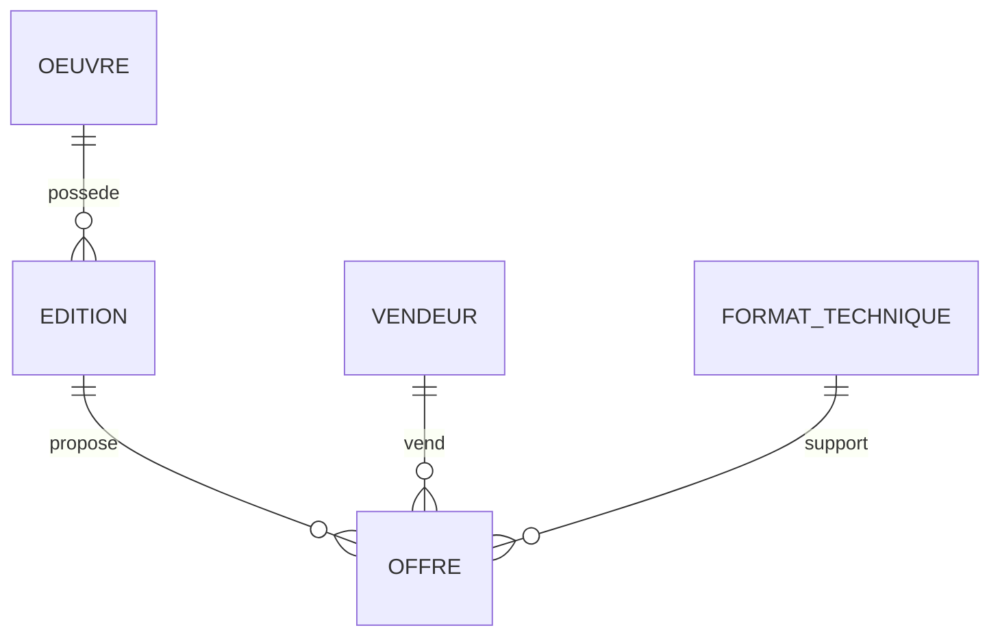

# MLD A2 — Découverte du catalogue — Afrique-Educ

Version 1.3 — 7 septembre 2026 — lot V1 consolidé pour préparation du MPD.

Modèle associé : [MOT_A2_V1_3_Consolide.md](MOT_A2_V1_3_Consolide.md). Contrat normatif commun : [Contrats V1.3](Contrats_inter_chaines_V1_3.md). [Guide du MPD](Guide_MPD_V1_3.md).

Base : fichier A2 du ZIP audité, révisé selon F01–F15 et recommandations approuvées. Provenance et empreintes dans le manifeste. Les compléments de données et procédures V1.3 sont intégrés ci-dessous ; la recette historique est complétée par les scénarios transversaux.

## 1. Conventions et périmètre

- `PK` : clé primaire ; `FK` : clé étrangère ; `UQ` : unicité ; `?` : nullable. Tout attribut non suivi de `?` est obligatoire.
- `ID` : identifiant stable dont le type physique sera harmonisé avec A1. `TEXTE`, `ENTIER`, `DECIMAL`, `BOOLEEN`, `DATE` et `INSTANT` sont des domaines logiques.
- Montants décimaux exacts, jamais flottants. Précision, longueurs et types SQL seront définis au MPD.
- Instants stockés selon une référence temporelle commune (UTC à l’implémentation) ; affichage local distinct.
- Les booléens optionnels du MCD deviennent obligatoires avec valeur initiale fausse, sauf mention contraire : cela évite les états publics indéterminés. Les référentiels sont activés explicitement.
- Les noms ci-dessous sont logiques. Ils ne supposent pas que les tables Laravel actuelles portent ces noms.
- Compte, Vendeur, Auteur et LicenceContenu ne doivent pas être recréés si les chaînes propriétaires les définissent déjà. `AUTEUR` représente ici la relation partagée complétée par A2.
- Favoris, suivi d’auteur, panier, licences, manuscrits, fichiers privés et packs commerciaux ne deviennent pas des tables A2.

## 2. Synthèse des relations

| Groupe | Relations | Portée |
|---|---|---|
| Cœur | OEUVRE, EDITION, FORMAT_TECHNIQUE, OFFRE | Contenu, manifestations, supports, propositions commerciales |
| Acteurs et référentiels | AUTEUR, EDITEUR, CATEGORIE, LANGUE, NIVEAU_EDUCATIF, COLLECTION, TAG_AUTEUR | Fiches et classement |
| Associations | OEUVRE_AUTEUR, OEUVRE_CATEGORIE, OEUVRE_LANGUE, AUTEUR_TAG | Associations plusieurs-à-plusieurs |
| Vitrine | SELECTION_EDITORIALE, SELECTION_OEUVRE | Sélections calculées ou manuelles |
| Consultation | MEDIA_CATALOGUE, AVIS | Dérivés publics et retours des lecteurs |

**19 relations logiques décrites**, dont AUTEUR partagé avec A1. Les alias externes COMPTE = comptes et VENDEUR = vendeurs ne sont pas comptées comme créations A2.

## 3. Dictionnaire relationnel

### 3.1 OEUVRE

```text
OEUVRE(
  oeuvre_id ID PK,
  slug TEXTE UQ,
  titre TEXTE,
  sous_titre TEXTE?, resume TEXTE?, pages ENTIER?,
  langue_principale_id ID? FK -> LANGUE.langue_id,
  statut {draft, published, archived},
  availability {available, soon},
  badge TEXTE?, africain BOOLEEN, mis_en_avant BOOLEEN,
  publie_a INSTANT?,
  note_moyenne DECIMAL?, avis_count ENTIER,
  retire_a INSTANT?,
  niveau_educatif_id ID? FK -> NIVEAU_EDUCATIF.niveau_educatif_id,
  collection_id ID? FK -> COLLECTION.collection_id
)
```

- Création : statut draft, africain/mis_en_avant faux, avis_count = 0, note_moyenne nulle ; availability renseignée explicitement.
- `pages`, si renseigné, > 0. Les propriétés éditoriales restent au niveau Œuvre comme dans le MCD validé ; une pagination propre à chaque Édition demanderait une évolution de celui-ci.
- Une Œuvre peut être préparée sans Édition, Offre, auteur ou langue. Avant publication : au moins une contribution OEUVRE_AUTEUR, une langue OEUVRE_LANGUE et publie_a renseigné.
- La langue principale, lorsqu’elle existe, doit appartenir à OEUVRE_LANGUE pour cette Œuvre. Invariant multi-relationnel, à assurer transactionnellement ; ne pas introduire de dépendance circulaire bloquant la création progressive.
- `badge` n’est jamais une source indépendante de gratuité. Aucun état `availability = free`.
- note_moyenne et avis_count sont des projections dérivées des Avis published non masqués par une cause opposable, non éditables par MOD. Aucun avis publié : moyenne NULL et compteur 0.

### 3.2 EDITION

```text
EDITION(
  edition_id ID PK,
  oeuvre_id ID FK -> OEUVRE.oeuvre_id,
  editeur_id ID? FK -> EDITEUR.editeur_id,
  isbn TEXTE?, titre_edition TEXTE?, editeur_legal_libelle TEXTE?,
  role_ae {distributeur, prestataire, editeur_label},
  responsable_depot TEXTE?, territoire TEXTE?, date_edition DATE?,
  statut_depot TEXTE?,
  statut {active, archived}, consultable BOOLEEN
)
```

- Une seule Œuvre par Édition, 0,N Éditions par Œuvre ; 0,N Offres par Édition.
- consultable initialement faux. Un retrait A6 est porté par la cause partagée et bloque V-E ; consultable garde l’intention éditoriale de base, sans écrasement pour simuler la mesure.
- ISBN reste nullable sans unicité globale ; la déclaration normalisée et validée isbn_demandes A5 fournit la valeur. Aucun ISBN n’est généré par absence de donnée.
- `role_ae` décrit chaque Édition ; il ne constitue pas une décision juridique globale pour la plateforme. Les données de dépôt validées A5 sont projetées dans les libellés A2 ; les droits opposables sont les associations CT-06, pas ce texte descriptif.

### 3.3 FORMAT_TECHNIQUE

```text
FORMAT_TECHNIQUE(
  format_id ID PK,
  code {epub, pdf, audio, paper} UQ,
  libelle TEXTE, sort_order ENTIER, actif BOOLEEN
)
```

sort_order ≥ 0. Le support doit être actif pour rendre une Offre visible. L’ajout de nouveaux codes est une évolution du référentiel.

### 3.4 OFFRE

```text
OFFRE(
  offre_id ID PK,
  edition_id ID FK -> EDITION.edition_id,
  format_id ID FK -> FORMAT_TECHNIQUE.format_id,
  vendeur_id ID FK -> vendeurs.id [contrat commerce A1 §4.2],
  modalite_commerciale {achat, location},
  prix DECIMAL,
  devise {CDF, USD},
  condition {none, new, used},
  sku TEXTE?, actif BOOLEEN, stock ENTIER?, retire_a INSTANT?,
  UQ(edition_id, format_id, vendeur_id, condition, modalite_commerciale, devise)
)
```

- prix ≥ 0 ; gratuit est calculé par `prix = 0`, sans colonne modifiable concurrente.
- `paper` impose new ou used ; epub/pdf/audio imposent none. Contrainte inter-relationnelle, le code du format n’est pas dupliqué dans OFFRE.
- Stock, si renseigné, ≥ 0 ; NULL signifie non renseigné/non applicable, pas disponibilité illimitée garantie. A3 contrôle la capacité réelle à satisfaire la transaction.
- Plusieurs vendeurs, modalités et devises peuvent coexister. Deux lignes CDF/USD sont des Offres distinctes : ne pas les traiter comme une conversion ni additionner automatiquement leur stock. La source de disponibilité et sa mutualisation relèvent d’A3.
- Une seule formule de location par combinaison de la clé est représentable dans cette version A2. Les formules, durées, cautions éventuelles et règles de disponibilité ne sont pas inventées. Si A3 autorise plusieurs formules pour une combinaison, la clé devra inclure leur identité lors de la consolidation, avant activation de ces offres.
- Une Offre de location ne devient transactionnelle qu’après validation de ses conditions par A3/A4. La gratuité d’une location ne crée pas un droit permanent.
- Aucun UQ sur sku ajouté sans contrat A3 ; offre_id est l’identifiant transmis pour toute sélection.

### 3.5 AUTEUR — relation partagée A1/A2

```text
AUTEUR(
  auteur_id ID PK,
  compte_id ID? FK -> comptes.id [A1],
  slug TEXTE UQ, nom_affiche TEXTE, bio TEXTE?, pays TEXTE?,
  role_affiche TEXTE?, verified BOOLEEN, mis_en_avant BOOLEEN,
  actif BOOLEEN,
  statut_publication {draft, published, archived},
  UQ(compte_id) pour les valeurs non nulles
)
```

Un compte possède au plus une fiche Auteur ; une fiche peut ne correspondre à aucun compte. Réutiliser l’identité de la fiche draft A1, ne jamais en créer une seconde lors de sa publication. Visibilité = published ET actif. `verified` reste un indicateur fourni par le processus habilité, pas une preuve de droit commercial ou de KYC déduite par A2.

### 3.6 EDITEUR

```text
EDITEUR(
  editeur_id ID PK,
  slug TEXTE UQ, nom TEXTE,
  type {publisher, house}, presentation TEXTE?, pays TEXTE?,
  is_partner BOOLEEN, is_academic BOOLEEN, is_youth BOOLEEN,
  is_african BOOLEEN, is_indie BOOLEEN,
  mis_en_avant BOOLEEN, actif BOOLEEN
)
```

Vitrine publique distincte du vendeur contractuel. Ne pas assimiler EDITEUR à VENDEUR ni aux libellés légaux d’Édition.

### 3.7 CATEGORIE

```text
CATEGORIE(
  categorie_id ID PK,
  parent_id ID? FK -> CATEGORIE.categorie_id,
  slug TEXTE, nom TEXTE, sort_order ENTIER, actif BOOLEEN,
  UQ(parent_id, slug) pour parent non nul,
  UQ(slug) parmi les racines
)
```

parent_id ≠ categorie_id, aucun cycle, sort_order ≥ 0. Le MPD doit garantir l’unicité des racines malgré les règles SQL sur NULL. Résolution par identifiant ou chemin complet ; jamais par slug local seul. Un ancêtre inactif ferme sa branche de navigation.

### 3.8 LANGUE

```text
LANGUE(langue_id ID PK, code TEXTE UQ, nom TEXTE, actif BOOLEEN)
```

Code normalisé dans le référentiel ; pas de duplication par différence de casse. La convention précise de code sera fixée à l’import du référentiel.

### 3.9 NIVEAU_EDUCATIF

```text
NIVEAU_EDUCATIF(
  niveau_educatif_id ID PK,
  parent_id ID? FK -> NIVEAU_EDUCATIF.niveau_educatif_id,
  slug TEXTE UQ, nom TEXTE, sort_order ENTIER, actif BOOLEEN
)
```

Arbre sans cycle ni auto-parenté ; sort_order ≥ 0. Une Œuvre possède 0 ou 1 niveau dans le modèle validé ; pas de pivot multi-niveaux ajouté. Le slug globalement unique est la convention logique retenue pour ce référentiel, contrairement aux catégories dont l’unicité par parent est explicite.

### 3.10 COLLECTION

```text
COLLECTION(
  collection_id ID PK,
  editeur_id ID? FK -> EDITEUR.editeur_id,
  slug TEXTE UQ, nom TEXTE,
  kind {collection, bundle}, actif BOOLEEN
)
```

Une Œuvre appartient à 0 ou 1 Collection. `bundle` décrit ici un regroupement de vitrine uniquement : pas de prix, panier ou droit groupé implicite. Les packs achetables restent hors A2.

### 3.11 TAG_AUTEUR

```text
TAG_AUTEUR(tag_auteur_id ID PK, slug TEXTE UQ, nom TEXTE)
```

### 3.12 Associations de classement et contribution

```text
OEUVRE_AUTEUR(
  oeuvre_id ID FK -> OEUVRE.oeuvre_id,
  auteur_id ID FK -> AUTEUR.auteur_id,
  ordre_affichage ENTIER?, role TEXTE?,
  PK(oeuvre_id, auteur_id)
)
OEUVRE_CATEGORIE(
  oeuvre_id ID FK -> OEUVRE.oeuvre_id,
  categorie_id ID FK -> CATEGORIE.categorie_id,
  PK(oeuvre_id, categorie_id)
)
OEUVRE_LANGUE(
  oeuvre_id ID FK -> OEUVRE.oeuvre_id,
  langue_id ID FK -> LANGUE.langue_id,
  PK(oeuvre_id, langue_id)
)
AUTEUR_TAG(
  auteur_id ID FK -> AUTEUR.auteur_id,
  tag_auteur_id ID FK -> TAG_AUTEUR.tag_auteur_id,
  PK(auteur_id, tag_auteur_id)
)
```

Ordre de contribution ≥ 0 si présent ; tri stable par ordre renseigné puis auteur_id, valeurs absentes après les ordres renseignés. `role` permet author/coauthor/illustrator et le vocabulaire de contribution validé par A5. Un seul rôle par couple dans ce MLD, conformément à l’unicité du MCD.

### 3.13 SELECTION_EDITORIALE et SELECTION_OEUVRE

```text
SELECTION_EDITORIALE(
  selection_id ID PK,
  code TEXTE UQ, libelle TEXTE,
  regle_ou_manuelle {filtre, manuelle},
  parametres STRUCTURE?, actif BOOLEEN, sort_order ENTIER
)
SELECTION_OEUVRE(
  selection_id ID FK -> SELECTION_EDITORIALE.selection_id,
  oeuvre_id ID FK -> OEUVRE.oeuvre_id,
  sort_order ENTIER, ajoute_a INSTANT,
  PK(selection_id, oeuvre_id)
)
```

- STRUCTURE désigne un document de critères validés, pas du SQL ni du code exécutable libre. Choix physique JSON ou décomposition au MPD selon les besoins de requête.
- Mode filtre : paramètres requis et conformes au contrat RequeteCatalogue ; aucune appartenance manuelle active. Mode manuelle : paramètres nuls, ordre des lignes de SELECTION_OEUVRE puis oeuvre_id.
- Les changements de mode s’effectuent atomiquement : supprimer les lignes d’appartenance devenues inapplicables ou effacer les paramètres inutilisés avant validation du nouveau mode.
- `a_paraitre` : mode filtre, critère availability = soon ; seule sélection autorisant les Œuvres sans Offre visible.
- `tendances` : mode manuelle ; aucun calcul de popularité ni tri popular en V1.
- Ces codes sont stables et ne changent pas les prédicats publics. Une appartenance manuelle ne peut rendre visible une Œuvre retirée.

### 3.14 MEDIA_CATALOGUE

```text
MEDIA_CATALOGUE(
  media_catalogue_id ID PK,
  oeuvre_id ID? FK -> OEUVRE.oeuvre_id,
  edition_id ID? FK -> EDITION.edition_id,
  type {couverture, galerie, apercu}, reference_publique TEXTE,
  texte_alternatif TEXTE?, ordre ENTIER, actif BOOLEEN,
  retire_a INSTANT?, volume_apercu DECIMAL?, unite_volume TEXTE?
)
```

- XOR total : exactement un des deux rattachements oeuvre_id/edition_id est renseigné. Pas de lien polymorphe libre sans intégrité référentielle.
- ordre ≥ 0. Pour apercu, volume et unité obligatoires, volume > 0 et ≤ plafond configuré pour l’unité. Pour les autres types, ces deux champs sont nuls.
- La référence désigne un dérivé public limité, jamais l’original MediaPrive. Aucune URL de fichier intégral n’est stockée dans cette relation.
- « Public » signifie sans licence, pas sans contrôle de retrait. La diffusion, y compris via cache ou stockage, doit permettre de bloquer de nouvelles réponses après retrait confirmé. Une URL permanente incontrôlée serait incompatible avec cet invariant. Les copies déjà téléchargées ne sont pas révocables par A2.
- Rattachement Édition prioritaire pour une vue contextualisée, avec repli sur les médias Œuvre autorisés ; pas de sélection arbitraire d’une couverture d’une autre Édition.

### 3.15 AVIS

```text
AVIS(
  avis_id ID PK,
  compte_id ID FK -> comptes.id [A1],
  oeuvre_id ID FK -> OEUVRE.oeuvre_id,
  note ENTIER, corps TEXTE?,
  statut {pending, published, rejected}, soumis_a INSTANT,
  moderateur_compte_id ID? FK -> comptes.id [A1],
  modere_a INSTANT?, motif_rejet TEXTE?
)
```

| Contrainte | Expression logique |
|---|---|
| Note | Entier de 1 à 5 |
| Dépôt | Compte active et session normal ; Œuvre publique éligible ; pas de preuve d’achat/location |
| Exclusion | Aucun dépôt sur soon sans Offre visible |
| Unicité | Au plus une ligne pending ou published par (compte_id, oeuvre_id) ; plusieurs rejected permis |
| Pending | modere_a, moderateur_compte_id et motif_rejet nuls |
| Published | modere_a et moderateur_compte_id renseignés ; motif_rejet nul |
| Rejected | modere_a et moderateur_compte_id renseignés ; motif_rejet non vide |
| Chronologie | modere_a ≥ soumis_a lorsqu’il est renseigné |
| Transitions | pending → published/rejected ; published → rejected ; aucune republication directe d’un rejected |

L’unicité conditionnelle est un invariant obligatoire : le MPD choisira une contrainte adaptée et/ou une sérialisation explicite. Une vérification avant insertion sans protection concurrente ne suffit pas. Le statut et la dernière décision motivée sont conservés ; ce modèle ne promet pas un historique complet des décisions. Une nouvelle soumission après rejet crée un nouvel Avis et repasse par pending.

## 4. Traduction des cardinalités



| Association | Traduction |
|---|---|
| Œuvre → Édition → Offre | FK obligatoires côté enfant ; minimum nul côté parent pendant la préparation |
| Offre → Vendeur / Format | Deux FK obligatoires ; unicité commerciale du §3.4 |
| Édition → Éditeur | FK nullable dans EDITION |
| Œuvre → Niveau / Collection | Deux FK nullables dans OEUVRE |
| Collection → Éditeur | FK nullable dans COLLECTION |
| Compte ↔ Auteur | FK nullable unique dans AUTEUR |
| Arbres | FK réflexive nullable, contraintes anti-cycle |
| Associations N:N | PK composites des relations d’association |
| Média → Œuvre ou Édition | Deux FK nullables avec XOR total |
| Avis → auteur du dépôt / Œuvre | Deux FK obligatoires ; modérateur nullable selon état |

## 5. Intégrité, concurrence et suppression

| Réf. | Invariant | Mise en œuvre logique |
|---|---|---|
| C01 | Publication préparée | Contrôle transactionnel des contributions, langues, statut et date ; A5 propriétaire de la publication |
| C02 | Offre non ambiguë | Unicité complète, prix ≥ 0, code devise/modalité, état compatible avec format |
| C03 | Racines et arbres | Unicité effective des racines, absence de cycles contrôlée y compris lors d’un déplacement concurrent |
| C04 | Média autorisé | XOR, parent public, plafond, non retrait ; contrôle à la diffusion |
| C05 | Avis non dupliqué | Unicité conditionnelle sous concurrence, vérification des droits à la soumission |
| C06 | Décision de modération | Transition conditionnelle sur l’état courant ; une décision concurrente ne l’écrase pas silencieusement |
| C07 | Agrégats exacts | Recalcul idempotent des seuls published non masqués selon CT-03 ; protection contre une écriture obsolète après un recalcul plus récent |
| C08 | Sélection cohérente | Mode exclusif et données compatibles modifiés atomiquement |
| C09 | Retrait effectif | Autorité métier mise à jour et diffusion invalidée avant confirmation ; projection de recherche non souveraine |
| C10 | Identités partagées | Pas de duplication A1 ni de FK vers une cible A4 non confirmée |

Par défaut, supprimer physiquement un parent encore référencé est interdit. Archiver, retirer ou désactiver préserve les relations. Les associations purement descriptives peuvent être retirées par une opération explicite, sous contrôle des minima de publication. Aucune cascade supprimant des Avis, offres commerciales ou comptes n’est prescrite. La politique de conservation et d’anonymisation des identités reste celle d’A1 ; elle ne se déduit pas d’une fermeture de compte.

## 6. Visibilité et requêtes logiques

| Prédicat | Définition |
|---|---|
| V-O | OEUVRE.statut = published et retire_a NULL et non bloque(Œuvre,retrait_catalogue,t) |
| V-E | V-O et EDITION.statut = active et consultable vrai et non bloque(Édition,retrait_catalogue,t) |
| V-F | V-E et OFFRE.actif vrai et retire_a NULL et FORMAT_TECHNIQUE.actif vrai et non bloque(Offre,retrait_catalogue,t) et non bloque(Offre,arret_ventes,t) |
| V-A | AUTEUR.statut_publication = published et actif vrai |
| V-W | V-O et (existence d’une Offre V-F ou (availability = soon et (contexte = fiche directe ou contexte = sélection a_paraitre active))) |

**Ordre de traitement** : normaliser les critères → vérifier les contextes et prédicats → rechercher les Offres correspondantes → dédupliquer les Œuvres → calculer la clé de tri → trier de façon stable → paginer → projeter les seuls objets autorisés.

- Format, modalité, condition, gratuité, devise et prix sont satisfaits par une même Offre V-F. Si l’éditeur d’Édition est filtré, cette même Offre appartient à une Édition V-E de cet éditeur actif.
- Une Œuvre sans Offre V-F apparaît seulement dans a_paraitre et sa fiche directe. Elle n’est pas réintroduite par un filtre availability, une bibliographie ou une sélection manuelle.
- Devise de comparaison : USD initialement, CDF possible ; aucune conversion. Avec filtre/tri de prix, minimum des prix des Offres correspondantes dans la devise choisie ; exclure les Œuvres sans tel prix. Hors filtre/tri de prix, afficher chaque devise réelle. Un filtre explicite devise reste restrictif.
- Une carte peut afficher plusieurs offres ; toute offre hors du sous-ensemble filtré éventuellement présentée comme alternative doit être clairement distinguée. Jamais de prix minimum dérivé d’une offre qui ne correspond pas aux critères.
- Comparer achat/location ensemble donne un prix minimum d’offres, pas un coût d’usage équivalent ; afficher la modalité et permettre son filtrage. Ne pas prétendre comparer des durées de location non définies.
- recent : publie_a décroissant, oeuvre_id pour départage. price asc/desc : montant correspondant puis oeuvre_id. Sélection manuelle : sort_order puis oeuvre_id. popular : erreur de critère non autorisé.
- Texte : titre, nom d’auteur V-A, ISBN d’Édition V-E, catégories actives ; aucune donnée cachée utilisée pour révéler un résultat. Les métadonnées jointes sont également filtrées.
- Référentiels et Editeur/Collection publics : actifs ; catégories et niveaux navigables uniquement sous des ancêtres actifs.
- Bibliographies d’auteur : relations OEUVRE_AUTEUR et Œuvres V-W en contexte bibliographie. Éditeur : présenter séparément Éditions V-E de l’éditeur et Collections actives qu’il porte ; dédupliquer dans chaque ensemble.
- Avis publics : published, non bloque(Avis,masquer_avis,t) et fiche autorisée. Aperçus : média et cible autorisés et non bloque(MediaCatalogue,masquer_media_public,t). Un accès direct à un média ou à un endpoint d’avis applique le contexte de sa fiche, pas un contournement de visibilité.
- Les comptes et facettes utilisent les mêmes règles. Un index périmé peut fournir des candidats, jamais autoriser une diffusion ; le remplissage de page doit tenir compte des candidats invalidés avant pagination effective.

## 7. Objets logiques sans table métier imposée

| Objet | Contenu / responsabilité |
|---|---|
| RequeteCatalogue | Texte, catégories, formats, langues, niveaux, prix min/max, devise, modalité, gratuité, état, disponibilité, badge, africain, auteur, éditeur, sélection, tri, page, taille ; DTO validé |
| IndexCatalogue | Projection reconstruisible ; source relationnelle authoritative ; outil choisi au MPD |
| Configuration A2 | Bornes de texte/pagination, plafonds d’aperçu par unité ; paramètres contrôlés, pas valeurs métier inventées |
| Livraison inter-chaînes | Réutiliser messages_sortants, transmissions_messages, tentatives_transmission et receptions_messages pour A1→A2 ; IA-05 (§11). Aucun registre d’envoi parallèle |
| Travaux propres au catalogue | Synchronisation/recalcul et suivi de cible/version/reprise : mécanisme technique à choisir au MPD ; ne pas détourner taches_service A1, dont la cible est un dossier KYC ou une demande support |
| SessionAuthentification | sessions_authentification d’A1 ; IA-02 (§11) ; aucun registre concurrent en A2 |
| Droit de lecture effectif | Réponse A4 pour le compte et contenu/support ; aucun raccourci FK OFFRE → LicenceContenu supposé |

Le MOT utilise ces objets pour l’exploitation, sans ajouter une table métier non motivée. La remise fiable A1→A2 est désormais celle d’A1 (§11). Le suivi des travaux internes A2 reste un choix MPD ; un simple envoi en mémoire après commit ne garantit pas la reprise.

## 8. Mapping et préparation du MPD

| Lot 1 indiqué par les sources A2 | Cible logique | Action de conception |
|---|---|---|
| books | OEUVRE + EDITION | Séparer les attributs ; préparer une Édition initiale pour chaque livre existant après contrôle des données |
| book_formats | OFFRE | Relier l’Édition, le vendeur, la modalité et la devise ; ne pas inventer les valeurs manquantes |
| formats | FORMAT_TECHNIQUE | Réutiliser et normaliser les codes |
| authors | AUTEUR partagé A1 | Conserver identifiants et liens de compte ; appliquer statut_publication |
| publishers / categories | EDITEUR / CATEGORIE | Conserver identités et nettoyer collisions de slugs |
| Pivots existants | OEUVRE_AUTEUR / OEUVRE_CATEGORIE | Remapper vers OEUVRE en préservant les relations |
| Autres relations | Relations A2 décrites | Créer selon l’inventaire réel du schéma lors du MPD |

Les tables réelles et les données du lot 1 n’ont pas été inspectées. Avant migration : inventaire du schéma, contrôle des orphelins/doublons, résolution des vendeurs et modalités, reprise des identifiants, validation des cardinalités et du nombre d’objets. Aucune migration n’est exécutée par ce document.

Accès à prévoir au MPD : clés inverses des pivots, chemins hiérarchiques, jointures Offre/Édition, statut d’Avis par Œuvre et file pending, codes/slugs, ordres de sélection. Les index composites physiques seront choisis d’après ces requêtes, pas ajoutés mécaniquement à tous les attributs.

## 9. Contrats inter-chaînes consolidés

| Interface | Contrat consolidé |
|---|---|
| A1 | Identités, auteur partagé, AUTH, permissions et événements CT-01/02 |
| A3 | Offre achat, prix/devise exacts, stock commun offres_stock ; location inactive ; éligibilité CT-06 |
| A4 | Réponse de droit par offre/version et origine ; bibliothèque CT-04/08 |
| A5 | Publication versionnée, droits opposables et réserves V1 CT-06 |
| A6 | Causes/levées du registre partagé et A2-90 CT-03 ; conservation CT-07 |

## 10. Traçabilité vers le MOT et critères de validation

| Règles | Relations / objets | Tâches MOT |
|---|---|---|
| D-A2-1/9 : Œuvre, Édition, offres distinctes | OEUVRE, EDITION, OFFRE, FORMAT_TECHNIQUE, VENDEUR | T01, T03, T09–T11 |
| D-A2-2/3/4/10 : visibilité | Prédicats, AUTEUR, référentiels | T01–T06, T13 |
| D-A2-5 : aperçu | MEDIA_CATALOGUE | T04, T13 |
| D-A2-6/13 : avis | AVIS, agrégats OEUVRE, COMPTE | T07, T08, T12 |
| D-A2-7/11 : recherche et devises | RequeteCatalogue, OFFRE, IndexCatalogue | T01, T13 |
| D-A2-8/12 : sélections | SELECTION_EDITORIALE, SELECTION_OEUVRE | T02, T06 |

Validation de la conception : toutes les opérations MCT sont couvertes dans le MOT ; chaque donnée métier persistante lue/écrite dispose d’une relation ou d’une interface identifiée ; les cas limites de recette figurent dans le MOT. Les interfaces sont consolidées par CT-01…CT-08 ; la recette applicative reste à réaliser.

## 11. Raccordement explicite au socle A1

| Référence A2 | Cible exacte / propriétaire | Intégrité |
|---|---|---|
| AUTEUR.compte_id | comptes.id — A1 | Nullable, unique lorsque non nul ; RESTRICT/NO ACTION |
| AVIS.compte_id | comptes.id — A1 | Obligatoire ; RESTRICT/NO ACTION |
| AVIS.moderateur_compte_id | comptes.id — A1 | Nullable selon état de modération ; RESTRICT/NO ACTION |
| OFFRE.vendeur_id | vendeurs.id — commerce, contrat A1 §4.2 | Obligatoire ; vendeurs.sujet_id → sujets_kyc.id ; pas de compte_id direct inventé |
| Contrôle de session | sessions_authentification.compte_id → comptes.id | Contrat d’accès, pas une nouvelle FK ajoutée à chaque Avis |
| MOD-V / MOD-A / EXP | permissions_internes + attributions_internes + comptes_roles/roles | Périodes et révocations A1 font autorité |

En base partagée, matérialiser les FK ci-dessus au MPD. En services séparés, conserver les identités et contrôles équivalents sans prétendre créer une FK inter-bases. Les alias COMPTE/VENDEUR dans les diagrammes désignent comptes/vendeurs ; ils ne sont pas des relations supplémentaires.

### Contrat partagé IA-01 à IA-06

Ces règles IA sont reprises et précisées par CT-01/CT-02 dans le contrat commun normatif de tous les modèles V1.3. Dans leurs procédures, « compte actif + session normale », « session valide » et « habilitation A1 » renvoient obligatoirement aux règles complètes ci-dessous.

| ID | Sujet | Contrat commun |
|---|---|---|
| IA-01 | Identités | A1 possède comptes.id et sessions_authentification.id. AUTEUR.compte_id, AVIS.compte_id et AVIS.moderateur_compte_id référencent comptes.id, avec le même domaine ID. A2 possède le catalogue Auteur et A1-08 utilise cette même identité ; compte_id nullable unique, aucune seconde fiche à la publication. |
| IA-02 | Session | À chaque action authentifiée : session liée au compte présenté, comptes.statut = active, session.portee = normal, session.statut = active, revoque_a NULL, heure courante strictement antérieure à expire_absolue_a ET expire_inactivite_a. Le registre A1 fait autorité ; limited/support_only ne valent pas normal. L’identité provient de la session vérifiée, jamais d’un compte_id libre du navigateur. |
| IA-03 | Permissions | Pour une décision humaine interne : IA-02 + rôle actif compatible + permission nominative courante. Vérifier attributions_internes.compte_id, permission_id, attribue_a ≤ maintenant, revoque_a NULL et expire_a NULL ou > maintenant. Rôles moderator/admin compatibles avec vitrine/avis ; support/admin compatibles avec reprise technique. Chaque rôle doit être actif dans comptes_roles. Aucun rôle ne donne seul la permission. |
| IA-04 | Catalogue et vendeur | OFFRE.vendeur_id référence vendeurs.id du contrat commercial A1 §4.2, sans dupliquer le vendeur ni le compte. vendeurs.sujet_id référence sujets_kyc.id ; ni rôle publisher, ni vendeur.actif, ni FK non nulle ne prouvent seuls l’habilitation commerciale actuelle. Les transactions A3 et mises en vente A5 contrôlent cette habilitation et son échéance. La consultation publique n’exige pas de KYC du visiteur. |
| IA-05 | Événements | A1 produit un message durable après mutation, avec transmission interne vers le consommateur A2. Utiliser messages_sortants, transmissions_messages, tentatives_transmission et receptions_messages du dispositif partagé ; dédupliquer par (producteur, evenement_externe_id, consommateur), relire l’état courant, acquitter après traitement validé. Aucun secret de session ni pièce KYC n’est envoyé au catalogue. |
| IA-06 | Révocation et conservation | Suspension/clôture/expiration/révocation empêchent immédiatement toute nouvelle action authentifiée selon IA-02/03, indépendamment du délai de propagation. La consultation publique reste possible. A2 ne supprime ni Avis, ni Auteur, ni Offre à cause de la seule fermeture d’un compte. Les retraits publics relèvent des états catalogue et d’A6 ; les licences restent sous A4. |

### Permissions A2 dans le dispositif A1

Ces codes complètent le référentiel permissions_internes. Ils sont à créer lors de l’implémentation ; aucune attribution à un compte réel n’est effectuée par ces documents.

| Code exact | Fonction et rôle compatible | Opérations / tâches autorisées | Limite |
|---|---|---|---|
| gerer_vitrine | MOD-V ; moderator ou admin actif | A2-16 / T06 : badges éditoriaux, mise en avant, sélections et ordre | Aucun pouvoir de modérer un avis ou d’accorder une licence |
| moderer_avis | MOD-A ; moderator ou admin actif | A2-42/A2-44 / T08 : publier, rejeter ou retirer un Avis avec motif requis | Aucun pouvoir KYC ou suspension de compte |
| reprendre_traitements_catalogue | EXP ; support ou admin actif | T14 : relancer/reconstruire index et agrégats d’A2 depuis l’état métier courant | Aucun droit de modifier les prix, publier un livre ou changer une décision d’avis |
| reprendre_transmissions | EXP ; support ou admin actif ; code A1 existant | Reprise d’une transmission technique A1→A2 dans le dispositif partagé | Ne permet pas de réexécuter une décision métier ni de remplacer la permission de reprise des travaux catalogue |

Attribution/révocation par un compte disposant de gerer_habilitations_internes, avec période et événement dans evenements_compte, conformément à A1. Pas d’auto-promotion. Les vérifications sont répétées à l’enregistrement de l’action ; une page ouverte avant expiration ne conserve pas un droit acquis. Une reprise SYS utilise une identité technique et une règle autorisée, jamais le compte usurpé d’un agent.

### Échanges A1 → A2

Les codes ci-dessous sont des contrats d’événement à implémenter, pas de nouvelles opérations numérotées A1. Ils se rattachent aux mutations existantes et aux événements déjà journalisés.

| Événement | Source | Effet A2 |
|---|---|---|
| compte_acces_modifie | A1-04/07/07a/22/23/24 selon mutation | Invalider les contextes personnalisés concernés et recontrôler IA-02 ; aucune réactivation d’une session révoquée |
| session_acces_modifie | A1-20/21 et toute révocation | Recontrôler le registre ; retirer les actions devenues indisponibles ; le contrôle courant reste indépendant du message |
| permission_interne_modifiee | Attribution/révocation interne journalisée | Invalider les capacités de back-office concernées et appliquer IA-03 ; ne pas changer le propriétaire d’une décision passée |
| auteur_compte_lie | A1-08 après rattachement autorisé | Réutiliser auteur_id/compte_id ; invalider les projections concernées ; ne pas passer automatiquement à published |
| habilitation_commerciale_modifiee | A1-12/13/14 | Invalider les informations d’éligibilité transactionnelle du vendeur ; A3/A5 décident sur l’état courant ; pas de retrait public automatique déduit par A2 |

Contrat minimal de charge : message_id, type, operation_source, correlation, date, compte_id et/ou identifiant de l’objet concerné (session, attribution, auteur, sujet) selon événement, version_objet si disponible. Les identifiants de catalogue peuvent figurer dans donnees_minimales ; ne pas créer une FK physique vers une base distante. Les effets sont obtenus en relisant la source, pas en faisant confiance à une ancienne charge « active ».

Une expiration peut être constatée lors d’un contrôle avant son événement de suivi : refuser immédiatement, puis tracer/synchroniser selon les règles A1. Pour l’invalidation d’un cache distant, acquitter après effet réalisé ou après enregistrement d’un travail durable assurant cet effet ; ne pas prétendre à une transaction atomique base/cache distant. IA-02/03 protègent l’accès pendant les reprises.

### Recette commune du raccordement

| ID | Cas | Résultat attendu |
|---|---|---|
| IA-R01 | Session portee normal mais expired, revoked ou hors échéance | Dépôt, gratuit, lecture et actions internes refusés ; public disponible |
| IA-R02 | Session active d’un autre compte ou compte suspended/closed | Aucune action au nom du compte présenté ; pas de confiance dans l’identité envoyée par le navigateur |
| IA-R03 | moderator/admin sans attribution gerer_vitrine ou moderer_avis | Action correspondante refusée |
| IA-R04 | Permission expirée/révoquée après ouverture du formulaire | Décision refusée à l’enregistrement ; aucune écriture métier |
| IA-R05 | A1-08 puis publication de la fiche | Même auteur_id ; compte_id unique ; aucune publication par le seul rattachement |
| IA-R06 | Livraison doublée ou événement ancien après suspension | Un seul effet logique, état courant prioritaire, accès toujours bloqué |
| IA-R07 | Compte fermé avec Avis/Auteur existants | Références conservées ; aucune suppression/publication/retrait automatique non prévu |
| IA-R08 | Vendeur actif avec habilitation commerciale expirée | Aucun droit de transaction ou mise en vente déduit de sa seule existence ; A3/A5 contrôlent l’autorisation |
| IA-R09 | EXP habilité uniquement à reprendre_transmissions | Reprise de livraison autorisée ; reconstruction catalogue et décision éditoriale refusées |

Ces scénarios sont des critères de recette documentaire à implémenter et exécuter ; aucun résultat applicatif n’est présumé.


## 12. Prédicats consolidés V1.3

Les champs actif/statut/consultable/retire_a gardent l’état éditorial de base ; les restrictions de conformité sont consultées dans restrictions_conformite/levees_restrictions, sans duplication de cause. Les agrégats d’avis excluent les published masqués ; le masque ne libère pas la contrainte d’unicité des avis non rejetés. Le contrôle courant de cause est obligatoire à l’endpoint, indépendamment de l’index.

Capacité commerciale V1 : achat seulement ; codes location et editeur_label réservés, non activables par A5 ni par import catalogue sans procédure future. Stock A2 est projection des unites_stock/offres_stock A3. Nouvel achat exige éligibilité CT-06. CT-08 règle le titre de bibliothèque privée, sans exposition de couverture/extrait retirés.


## Contrôles inter-chaînes obligatoires V1.3

Les règles CT-01…CT-08 sont des parties normatives de ce modèle. Propriétaire fonctionnel : A2. Base logique V1 commune, identités partagées et références canoniques du lot.

- CT-01 : contrôle actuel de session, permission, rôle et portée ; exceptions documentaires/phase nommées seulement.
- CT-02 : état métier + message atomiques ; déduplication intention/référence ; acquittement local distinct du résultat propriétaire.
- CT-03 : chaque lecteur/écrivain de cibles consulte les causes communes et leurs dates ; l’index n’est jamais l’autorité.
- CT-04/05 : acquisitions, extensions, argent et compensations restent propriétaires A4/A3 ; autre origine préservée.
- CT-06 : droits d’acte/version actuels ; offre sous restriction géographique non applicable reste en attente V1.
- CT-07 : création/rattachement de preuve appelle inscription conservation ; propriétaire ne détruit qu’après recontrôle sérialisé de tous gels/politiques.
- CT-08 : titre privé minimal autorisé ; secrets temporaires hors journaux ; aucun grant de recours ne permet de lire le livre.

Les tables support A1 taches_service restent réservées KYC/support : files des autres chaînes fondées sur leurs propres états. Les postes numérotés sont locaux, qualifiés A2-P… dans le MOT global. Les nouveaux traitements V1.3 complètent la couverture du MCT historique ; la recette transversale X01…X24 et ses adaptations figure au Guide MPD.
