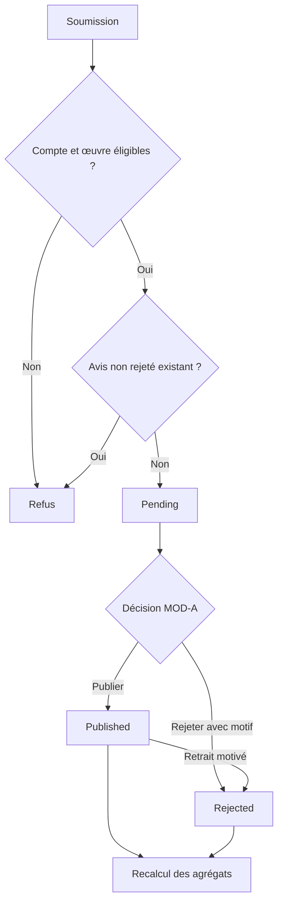

# MOT A2 — Découverte du catalogue — Afrique-Educ

Version 1.3 — 7 septembre 2026 — lot V1 consolidé pour préparation du MPD.

Modèle associé : [MLD_A2_V1_3_Consolide.md](MLD_A2_V1_3_Consolide.md). Contrat normatif commun : [Contrats V1.3](Contrats_inter_chaines_V1_3.md). [Guide du MPD](Guide_MPD_V1_3.md).

Base : fichier A2 du ZIP audité, révisé selon F01–F15 et recommandations approuvées. Provenance et empreintes dans le manifeste. Les compléments de données et procédures V1.3 sont intégrés ci-dessous ; la recette historique est complétée par les scénarios transversaux.

## 1. Acteurs, postes et responsabilités

| Code | Acteur / poste | Responsabilité | Conditions |
|---|---|---|---|
| VIS | Visiteur, navigateur public | Recherche, navigation, fiches, aperçus et avis publiés ; choix d’une Offre | Aucun compte nécessaire pour la découverte ou la demande d’ajout panier |
| LEC | Lecteur, navigateur connecté | Fonctions VIS + dépôt d’avis, demande gratuite, lecture selon droit | Compte active, session normal ; droit A4 supplémentaire pour lire |
| MOD-V | Modérateur habilité vitrine, espace d’administration | Badges éditoriaux, mise en avant, sélections et Tendances | IA-02/03 + gerer_vitrine (§9) |
| MOD-A | Modérateur habilité avis, file de modération | Publication/rejet et retrait motivé des avis | IA-02/03 + moderer_avis (§9) |
| SYS | Service applicatif A2 et traitements de fond | Contrôles, requêtes, projection, agrégats et synchronisation | Identité technique et accès nécessaires à la tâche |
| EXP | Responsable d’exploitation, console technique | Diagnostic et relance des travaux en échec | IA-02/03 + reprendre_traitements_catalogue ; reprendre_transmissions pour les livraisons A1→A2 (§9) |
| EXT | Services propriétaires A1/A3/A4/A5/A6 | Identités, transactions, droits, publication et retrait | Contrats du MLD §9 |

MOD-V et MOD-A sont deux habilitations du rôle fonctionnel MOD existant. Une même personne peut les détenir. EXP matérialise la responsabilité d’exploitation nécessaire aux reprises SYS ; il n’ajoute pas une nouvelle entité métier au MCD.

## 2. Nature, temporalité et lieux d’exécution

| Nature | Sens | Exemple |
|---|---|---|
| I — interactif automatisé | Une action utilisateur déclenche une réponse applicative | Recherche ou consultation de fiche |
| H — décision humaine assistée | L’agent prend une décision, l’application contrôle et enregistre | Publication d’un avis |
| A — automatique différé | Travail déclenché par événement, suivi et rejouable | Recalcul ou indexation |

- Les traitements I répondent dans la requête ou par un résultat explicite ; aucun SLA en secondes n’est fixé ici.
- Les décisions H s’exécutent pendant les plages de prise en charge de l’équipe, à définir dans l’exploitation. L’avis reste pending tant qu’aucune décision n’a été enregistrée.
- Les traitements A démarrent après validation de la transaction source. La file de travaux et les mécanismes de remise fiable sont des objets techniques du MLD §7.
- La visibilité de retrait et les contrôles des droits ne sont pas différés derrière une indexation : le succès du retrait suppose la barrière de diffusion effective.
- Les postes publics utilisent navigateur/site ; les décisions éditoriales utilisent le back-office ; SYS s’exécute côté serveur ; EXP intervient en console d’exploitation.

## 3. Tableau des tâches organisationnelles

Lecture et écriture concernent les relations logiques du MLD. « Interface » ne signifie pas accès direct à une table d’un autre service.

| Tâche | Origine MCT | Acteur / poste, nature | Déclenchement et fréquence | Données lues / écrites | Résultat |
|---|---|---|---|---|---|
| T01 — Rechercher et filtrer | A2-01…04 | VIS/LEC → SYS, public, I | Chaque saisie validée, filtre, tri ou changement de page | L : RequeteCatalogue, index/cœur, auteurs et référentiels ; E : aucune donnée métier | Liste paginée d’Œuvres et Offres correspondantes ou erreur de critères |
| T02 — Naviguer dans catégories et sélections | A2-10/11/15 | VIS/LEC → SYS, public, I | Ouverture de menu, catégorie ou sélection | L : CATEGORIE, SELECTION_EDITORIALE/OEUVRE, puis données T01 | Menu actif, À paraître, Tendances ou liste filtrée |
| T03 — Consulter une fiche Œuvre | A2-20…24 | VIS/LEC → SYS, public, I | Accès par slug ou clic de carte | L : OEUVRE, EDITION, OFFRE, médias, métadonnées, AVIS ; interfaces A1/A4 si connecté | Fiche autorisée et actions appropriées ou 404 uniforme |
| T04 — Consulter un aperçu | A2-25 | VIS/LEC → SYS, public, I | Demande d’aperçu | L : MEDIA_CATALOGUE, cible, configuration des plafonds | Dérivé public limité ou refus |
| T05 — Consulter auteurs et éditeurs | A2-30…33/35…37 | VIS/LEC → SYS, public, I | Annuaire, fiche ou bibliographie | L : AUTEUR/TAG, EDITEUR, COLLECTION, contributions et catalogue | Fiches et bibliographies publiques paginées |
| T06 — Administrer la vitrine | A2-16 | MOD-V → SYS, administration, H | Action éditoriale | L/E : SELECTION_EDITORIALE/OEUVRE, badge/mis_en_avant OEUVRE ; événement T13 | Vitrine modifiée avec contrôles de mode et ordre |
| T07 — Lire et déposer un avis | A2-40/41 | VIS pour lecture ; LEC pour dépôt → SYS, public, I | Consultation ou soumission du formulaire | L : OEUVRE, AVIS, interface A1 ; E : AVIS pending | Avis publiés, dépôt en attente ou refus explicite |
| T08 — Modérer ou retirer un avis | A2-42/44 | MOD-A → SYS, administration, H | Prise en charge d’un pending ou décision de retrait | L/E : AVIS ; interface A1 ; événement T12 | Décision motivée et datée ; avis publié ou rejeté |
| T09 — Demander un ajout au panier | A2-26 | VIS/LEC → SYS puis A3, public, I | Choix d’Offre et quantité | L : OFFRE et contexte ; E A2 : aucune ligne panier | Demande A3 ; confirmation ou refus par A3 |
| T10 — Demander une obtention gratuite | A2-27 | LEC → SYS puis A3, public, I | Choix d’Offre à prix nul | L : OFFRE, interface A1 ; E A2 : aucun droit | Demande A3-20 avec modalité ; résultat A3 |
| T11 — Demander la lecture | A2-28 | LEC → SYS puis A4, public, I | Action Lire | L : contexte de contenu/support, interfaces A1/A4 | Autorisation/refus A4 ; aucune URL privée fournie par A2 |
| T12 — Recalculer les agrégats | A2-43 | SYS, serveur, A ; repli cohérent en I | Après chaque publication/rejet/retrait | L : AVIS published ; E : OEUVRE.note_moyenne/avis_count | Agrégats exacts et invalidation des projections concernées |
| T13 — Synchroniser et appliquer les retraits | A2-50 et messages §5 | SYS, serveur, I pour barrière de retrait + A pour projections | Toute mutation impactant recherche/visibilité | L : état métier ; E : index/cache, suivi d’exécution ; mutation métier par son propriétaire | Projections à jour ; aucun contenu retiré nouvellement diffusé |
| T14 — Reprendre un traitement en échec | Support T12/T13, MCT §10 bis | EXP/SYS, console/serveur, H/A | Échec détecté, travail manquant ou reconstruction | L : suivi d’exécution, source ; E : relance et projections | Reprise vérifiée, sans modifier arbitrairement les données métier |

## 4. Procédures détaillées

### 4.1 T01/T02 — Recherche et navigation

1. SYS normalise texte, identifiants, bornes de prix, pagination et tri. Valeur initiale de devise USD ; le lecteur peut choisir CDF. Critère invalide : réponse explicite, jamais abandon silencieux d’un filtre.
2. Résoudre les catégories par chemin complet ou identifiant. Charger uniquement les branches actives ; appliquer les descendants actifs lorsque l’option de descendance est utilisée.
3. Résoudre la sélection active et son mode. `a_paraitre` utilise le filtre soon ; `tendances` utilise l’ordre manuel. Les autres sélections gardent leur mode exclusif.
4. Appliquer les prédicats MLD §6. Seule la sélection a_paraitre autorise en liste les Œuvres soon sans Offre visible ; un paramètre availability=soon ne contourne pas cette limite dans une recherche générale.
5. Vérifier format, modalité, état, prix, devise et gratuité sur la même Offre. Avec filtre éditeur, retenir la même Édition publique de cet éditeur.
6. Dédupliquer les Œuvres puis calculer le prix de référence parmi les offres correspondantes. Filtre/tri de prix : exclure celles sans prix dans la devise choisie ; aucune conversion. Hors recherche de prix, présenter les devises réelles.
7. Trier de manière stable : recent, prix asc/desc, ou ordre de sélection. popular est refusé. Tendances conserve son ordre manuel dans sa vue dédiée.
8. Paginer et construire la projection : titre, auteurs V-A, média autorisé, Offres et vendeur/modalité/devise clairement distingués. Compteurs et facettes suivent le même filtre de visibilité.

**Repli** : si l’index est indisponible ou obsolète, utiliser la source relationnelle lorsque le repli est disponible ; sinon fournir une indisponibilité maîtrisée. Ne jamais servir un résultat caché pour maintenir artificiellement une page pleine. Les listes ne créent ni compte ni historique persistant de recherche en A2 V1.

### 4.2 T03/T04/T05 — Fiches et médias

- Résoudre l’objet et contrôler son état avant de charger les données publiques. Œuvre inconnue/draft/archived/retirée : même 404. Auteur : published ET actif ; éditeur : actif.
- Fiche soon sans Offre visible : accès direct autorisé ; pas de prix zéro inventé ni de demande d’achat, location, gratuit ou précommande. Le dépôt d’avis est désactivé et refusé côté serveur.
- Charger Éditions V-E, Offres V-F, auteurs V-A, métadonnées actives et avis published. Chaque Édition garde son éditeur ; le catalogue de Collection ne prouve pas la publication de toutes les Éditions par cet éditeur.
- Bibliographies : seules les Œuvres visibles dans ce contexte. Les soon sans Offre n’y figurent pas. Pour l’éditeur, distinguer ses Éditions et ses Collections.
- Avant aperçu, recontrôler média et parent, XOR de rattachement, plafond et non retrait. Servir le dérivé limité ; ne jamais charger l’original complet pour en cacher une partie côté navigateur.
- Afficher Lire seulement après vérification positive du droit A4 pour un lecteur actif en session normale. Pour une autre modalité/support, proposer les offres correspondantes sans déduire un droit universel.
- Indisponibilité du service de droits : état de vérification indisponible et possibilité de réessayer ; ne pas conclure automatiquement « aucun droit » ni autoriser la lecture.

### 4.3 T06 — Pilotage de la vitrine

| Étape | Responsable | Contrôles / effet |
|---|---|---|
| Ouvrir la vitrine | MOD-V / SYS | Vérifier habilitation, charger état actuel |
| Modifier badge/mise en avant | MOD-V | Ne pas écrire un badge gratuit indépendant du prix des Offres |
| Modifier une sélection | MOD-V | Mode filtre : critères autorisés ; mode manuelle : appartenance et ordre |
| Protéger les sélections fixes | SYS | tendances reste manuelle, a_paraitre reste filtre soon ; aucune sélection ne contourne un retrait |
| Enregistrer | SYS | Transaction cohérente ; refuser un conflit de modification non résolu |
| Actualiser la diffusion | SYS | Déclencher T13 ; réponse de succès correspondant à l’état métier validé |

Le MOD peut préparer une sélection inactive. Activer une sélection n’active pas ses Œuvres ou ses Offres. Les habilitations sont raccordées à permissions_internes/attributions_internes A1 : gerer_vitrine pour T06, moderer_avis pour T08 (§9). Les attributions nominatives sont à effectuer dans l’application par un agent habilité, sans privilège implicite.

### 4.4 T07/T08 — Avis et décisions

1. La lecture des Avis exige une Œuvre publique autorisée ; seuls published sont projetés.
2. Pour déposer, SYS vérifie Compte active + session normal, Œuvre V-W et absence de soon sans Offre visible. Aucun achat, location ou licence n’est exigé.
3. Valider note entière 1–5 et corps dans la limite configurée. Assurer l’unicité conditionnelle sous concurrence ; créer pending avec identité de l’auteur et date.
4. Réponse au lecteur : avis reçu pour modération. Le message décrit l’état effectivement enregistré ; aucune notification e-mail/Slack n’est ajoutée au périmètre.
5. MOD-A consulte la file pending. SYS vérifie son habilitation et l’état courant à l’enregistrement. Un conflit avec une autre décision est signalé plutôt qu’écrasé.
6. Publication : enregistrer modérateur/date, statut published et motif_rejet NULL. Rejet : modérateur/date et motif non vide, statut rejected.
7. Retrait éditorial définitif MOD-A : published → rejected avec dernière décision motivée. Une restriction A6 réversible est séparée : conserver ce statut et utiliser la cause CT-03 ; sa levée ne restaure jamais un avis rejected. L’avis est exclu immédiatement de la liste ; T12 recalcule les agrégats. Aucun historique exhaustif n’est promis par le MLD.
8. Après rejet, une nouvelle soumission crée un nouvel avis pending ; elle ne réactive pas l’ancienne ligne. L’unicité des avis non rejetés reste applicable.

**Réponses distinctes** : défaut d’authentification → parcours A1 ; œuvre non visible → réponse uniforme de ressource absente ; œuvre soon visible mais non éligible → dépôt indisponible ; doublon → avis déjà en attente/publié ; note invalide → erreur de saisie. Une œuvre non éligible ne doit pas provoquer une redirection d’authentification trompeuse.

### 4.5 T09/T10/T11 — Passages vers achat, gratuit et lecture

| Action | Préconditions A2 | Message de demande | Autorité de résultat |
|---|---|---|---|
| Ajouter au panier | Offre V-F, quantité valide, modalités et contexte choisis ; anonyme autorisé | offre_id, quantité, modalite_commerciale, devise de l’Offre, contexte/corrélation | A3-01 revalide Offre, prix, stock et conditions ; confirme ou refuse |
| Obtenir gratuit | Compte active, session normal, Offre V-F à prix nul et éligible | offre_id, modalite_commerciale, devise, contexte/corrélation | A3-20 revalide et accorde selon la modalité ; aucun droit créé par A2 |
| Lire | Compte active, session normal, droit A4 pour le contenu/support | Identité vérifiée du compte et cible de lecture convenue avec A4 | A4 recontrôle le droit à l’ouverture et gère la lecture |

- Les informations transmises par le navigateur ne font pas autorité sur le prix, le compte ou la modalité : le serveur recharge les références.
- La réponse A2 « demande transmise » n’est pas « ajouté au panier ». Un succès utilisateur n’est affiché qu’après confirmation du destinataire.
- Changement de prix/disponibilité : présenter le résultat A3 ; ne pas conserver silencieusement un ancien prix de carte.
- Double clic ou réponse perdue : utiliser le contrat d’idempotence/corrélation d’A3 avant relance ; ne pas émettre aveuglément une seconde opération.
- V1 : CTA location et gratuit-location désactivés ; A3 refuse ces modalités. Les codes réservés ne sont pas des capacités activées.
- Location non activée V1 ; disponibilité via offres_stock A3, licences/origines via CT-04.

### 4.6 T12/T13/T14 — Agrégats, synchronisation et reprise

| Événement source | Responsable source | Action A2 |
|---|---|---|
| Œuvre/Édition/Offre publiée ou modifiée | A5 / vendeur selon droits A3/A5 | Recharger l’état courant et actualiser les projections concernées |
| Prix, modalité, devise ou stock modifié | Propriétaire commercial | Actualiser cartes/recherche ; transaction toujours revalidée par A3 |
| Auteur publié, archivé ou désactivé | A5/MOD habilité | Actualiser annuaire, recherches et contributions publiques |
| Référentiel, média ou sélection modifié | Propriétaire habilité | Invalider les dépendances ; reconstruire à partir des sources |
| Avis publié, rejeté ou retiré | T08 / A6 | T12 recalcule ; invalider cartes/fiches affichant les agrégats |
| Contenu retiré | A6 | Barrière de visibilité immédiate, puis projection index/cache et suivi |
| Compte/session/permission modifiés | A1 | IA-02/03 à chaque action ; invalider le contexte personnalisé ; pas de suppression implicite d’avis publiés |

**Exécution fiable**
1. La remise fiable A1→A2 utilise le dispositif messages_sortants/transmissions_messages/tentatives_transmission/receptions_messages d’A1 (§9). Pour les mutations propres au catalogue, le mécanisme technique sera choisi au MPD sans registre concurrent de livraison inter-chaînes. Le suivi conserve cible, identifiant d’événement/version, état, erreur et tentatives dans l’infrastructure technique retenue.
2. Le travail recharge l’état courant ; un événement ancien ne republie jamais un contenu retiré. Rejouer le même événement produit le même état final.
3. T12 recalcule moyenne et compteur sur les seuls published non masqués selon CT-03. Éviter qu’un recalcul plus ancien écrase un plus récent : sérialiser par Œuvre ou contrôler la version avant écriture.
4. Tant qu’un agrégat persistant peut être obsolète, la consultation recalcule depuis les Avis actuels ou utilise une projection dont la fraîcheur est garantie ; ne pas présenter un agrégat retiré comme actuel. Le mécanisme de fraîcheur des agrégats est choisi au MPD.
5. Retrait : la source métier et le contrôle de diffusion bloquent immédiatement les nouvelles réponses, y compris celles des médias. La confirmation du retrait attend cette barrière, pas nécessairement la fin de la reconstruction de l’index.
6. Erreur de fond : conserver le travail en échec, détectable en console ; SYS peut réessayer selon paramètres d’exploitation. EXP intervient si nécessaire et vérifie le résultat. Aucun service de messagerie externe n’est présumé.
7. Reconstruction : repart des sources métier, contrôle les prédicats avant bascule de projection ; les lecteurs continuent à bénéficier du contrôle d’autorité.

## 5. Transactions et habilitations

| Opération | Frontière de cohérence | Écriture autorisée |
|---|---|---|
| Dépôt d’avis | Vérifier les conditions et créer sans doublon concurrent | LEC via SYS : sa nouvelle ligne pending uniquement |
| Modération | État attendu + décision + modérateur/date/motif + émission fiable du besoin de recalcul | MOD-A via SYS |
| Sélection | Mode, paramètres, appartenances et ordre compatibles | MOD-V via SYS |
| Recalcul | Agrégat complet et protection contre version ancienne | SYS uniquement |
| Publication/retrait de catalogue | Modification par chaîne propriétaire, propagation et contrôle de diffusion | A5/A6 et habilitations contractuelles ; pas un pouvoir implicite de VIS/LEC |
| Panier/licence | Traitement et idempotence dans la chaîne destinataire | A3/A4 ; aucune écriture directe par A2 |

Les journaux techniques servent à la reprise et au diagnostic ; ils ne remplacent pas une entité d’historique métier. Les accès de lecture au back-office ne confèrent pas automatiquement le droit de publier, rejeter ou retirer.

## 6. Matrice de couverture MCT → MOT → MLD

| Opérations MCT | Tâches MOT | Données / interfaces principales |
|---|---|---|
| A2-01, A2-02, A2-03, A2-04 | T01 | RequeteCatalogue, OEUVRE/EDITION/OFFRE, référentiels et index |
| A2-10, A2-11 | T02 → T01 | CATEGORIE, OEUVRE_CATEGORIE |
| A2-15 | T02 → T01 | SELECTION_EDITORIALE, SELECTION_OEUVRE |
| A2-16 | T06 → T13 | Sélections, badge et mis_en_avant OEUVRE |
| A2-20, A2-21, A2-22, A2-23, A2-24 | T03 | Cœur, médias, métadonnées, AVIS, interfaces A1/A4 |
| A2-25 | T04 | MEDIA_CATALOGUE et sa cible |
| A2-26 | T09 | OFFRE ; interface A3-01 |
| A2-27 | T10 | OFFRE ; interfaces A1/A3-20 |
| A2-28 | T11 | Interfaces A1/A4 |
| A2-30, A2-31, A2-32, A2-33 | T05 | AUTEUR, AUTEUR_TAG, TAG_AUTEUR, OEUVRE_AUTEUR |
| A2-35, A2-36, A2-37 | T05 | EDITEUR, EDITION, COLLECTION |
| A2-40, A2-41 | T07 | AVIS, OEUVRE, interface A1 |
| A2-42, A2-44 | T08 | AVIS, interface habilitation A1 |
| A2-43 | T12 | AVIS published → agrégats OEUVRE |
| A2-50 et synchronisations MCT §5 | T13/T14 | Sources et projections ; infrastructure technique |

T14 est une tâche de support organisationnel explicitant la reprise prévue au MCT, sans nouveau processus métier Pnn. Tous les identifiants A2 listés sont couverts ; les nouveaux raccordements V1.3 sont précisés dans les procédures réceptrices et CT-02…CT-05.

## 7. Scénarios de recette à réaliser

Ces scénarios constituent un plan de vérification, pas des résultats d’exécution.

| ID | Scénario | Résultat attendu | Tâches |
|---|---|---|---|
| R01 | Brouillon sans Édition/Offre | Création possible ; publication soumise aux minima ; invisible publiquement | T01/T03 |
| R02 | Auteur published mais inactif | Absent de l’annuaire, des métadonnées et des termes de recherche publics | T01/T03/T05 |
| R03 | Œuvre retirée présente dans un index ancien | Aucune nouvelle liste, fiche ou diffusion de média autorisée | T01/T03/T04/T13 |
| R04 | Même édition/format/état, deux vendeurs | Deux Offres distinctes, même Œuvre non dupliquée dans la pagination | T01/T03 |
| R05 | Achat et location pour le même format | Modalités et prix distincts, référence exacte transmise | T03/T09 |
| R06 | PDF payant et EPUB gratuit ; filtre PDF + gratuit | Œuvre non retenue par combinaison de deux Offres différentes | T01 |
| R07 | USD initial, passage CDF, filtre/tri de prix | Aucun montant converti ; seulement les Offres correspondantes dans la devise choisie | T01 |
| R08 | Aucune Offre dans la devise de comparaison | Exclue de recherche de prix ; prix réels possibles hors filtre/tri de prix | T01 |
| R09 | Soon sans Offre visible | Accessible seulement dans À paraître et fiche directe ; aucune transaction ni dépôt d’avis | T01/T02/T03/T07/T09/T10 |
| R10 | Modification de l’ordre de Tendances | Ordre manuel reflété ; popular refusé | T02/T06 |
| R11 | Catégories de même slug sous parents distincts | Résolution par chemin/id correcte, racines sans doublon, cycle refusé | T02 |
| R12 | ISBN d’Édition cachée | Aucune révélation de cette Édition par la recherche | T01 |
| R13 | Aperçu avec volume excédentaire ou lien vers original | Diffusion refusée ; seules les ressources publiques plafonnées sont servies | T04 |
| R14 | Compte actif sans achat | Dépôt autorisé sur œuvre éligible, état pending | T07 |
| R15 | Deux dépôts simultanés même compte/œuvre | Au plus un avis non rejeté créé | T07 |
| R16 | Rejet sans motif ou compte non habilité | Décision refusée ; état existant conservé | T08 |
| R17 | Retrait du dernier Avis published | Avis invisible, avis_count 0 et note_moyenne NULL ; pas de projection obsolète présentée | T08/T12/T13 |
| R18 | Deux décisions ou recalculs concurrents | Pas d’écrasement silencieux ni de retour à un agrégat ancien | T08/T12 |
| R19 | Compte suspendu, session non normale | Dépôt/gratuit/lecture bloqués ; consultation publique conservée | T03/T07/T10/T11 |
| R20 | Droit A4 absent ou service indisponible | Refus de lecture ou état indisponible distinct ; aucun fichier privé délivré par A2 | T03/T11 |
| R21 | Prix/stock changé entre fiche et panier | A3 décide sur état courant et renvoie confirmation/refus ; A2 n’annonce pas de succès prématuré | T09 |
| R22 | Location gratuite | Demande conserve la modalité ; aucun droit permanent déduit | T10/T11 |
| R23 | Échec puis rejeu d’indexation, ancien événement après retrait | Reprise idempotente, état courant préservé, aucune republication | T13/T14 |
| R24 | Nouveau dépôt après rejet | Nouvelle ligne pending si éligible ; ancien rejet conservé | T07/T08 |

## 8. Passage au MPD et à l’organisation réelle

1. Appliquer le contrat A1 désormais raccordé (§9 du présent MOT), puis consolider les interfaces A3/A4/A5/A6 du MLD §9, en particulier formules de location, mutualisation de disponibilité et cible du droit de lecture.
2. Traduire les relations et contraintes en MPD, puis migrations sur le schéma réel. Choisir les moyens de remise fiable, unicité conditionnelle, invalidation et contrôle de versions.
3. Affecter les habilitations MOD-V/MOD-A et EXP ; fixer plages de modération, suivi des travaux et objectifs de délai selon l’équipe disponible.
4. Implémenter les tâches et exécuter R01–R24 avec preuves de résultats. Les décisions métier D-A2-9 à D-A2-13 sont déjà validées et n’attendent aucune nouvelle confirmation.

## 9. Raccordement organisationnel à A1

Les fonctions A2 publiques utilisent P1 d’A1 ; les actions personnelles P2 ; MOD-V/MOD-A P3 ; SYS/EXP P4. Le rôle reader seul n’exige pas de KYC pour déposer un Avis. Les contrôles d’accès s’appliquent avant écriture et à l’enregistrement des décisions concurrentes. Défaut d’identité/session : parcours A1 adapté ; permission insuffisante : refus d’accès, sans redirection trompeuse vers le login ; autorité A1 indisponible : action protégée indisponible, consultation publique conservée lorsque ses sources sont disponibles.

Les événements sont consommés par T13, avec suivi/reprise T14. Ne pas insérer les Avis dans taches_service A1 : cette relation cible uniquement KYC/support. La file pending A2 reste fondée sur AVIS ; aucun nouveau circuit d’affectation KYC n’est appliqué implicitement aux avis.

### Contrat partagé IA-01 à IA-06

Ces règles IA sont reprises et précisées par CT-01/CT-02 dans le contrat commun normatif de tous les modèles V1.3. Dans leurs procédures, « compte actif + session normale », « session valide » et « habilitation A1 » renvoient obligatoirement aux règles complètes ci-dessous.

| ID | Sujet | Contrat commun |
|---|---|---|
| IA-01 | Identités | A1 possède comptes.id et sessions_authentification.id. AUTEUR.compte_id, AVIS.compte_id et AVIS.moderateur_compte_id référencent comptes.id, avec le même domaine ID. A2 possède le catalogue Auteur et A1-08 utilise cette même identité ; compte_id nullable unique, aucune seconde fiche à la publication. |
| IA-02 | Session | À chaque action authentifiée : session liée au compte présenté, comptes.statut = active, session.portee = normal, session.statut = active, revoque_a NULL, heure courante strictement antérieure à expire_absolue_a ET expire_inactivite_a. Le registre A1 fait autorité ; limited/support_only ne valent pas normal. L’identité provient de la session vérifiée, jamais d’un compte_id libre du navigateur. |
| IA-03 | Permissions | Pour une décision humaine interne : IA-02 + rôle actif compatible + permission nominative courante. Vérifier attributions_internes.compte_id, permission_id, attribue_a ≤ maintenant, revoque_a NULL et expire_a NULL ou > maintenant. Rôles moderator/admin compatibles avec vitrine/avis ; support/admin compatibles avec reprise technique. Chaque rôle doit être actif dans comptes_roles. Aucun rôle ne donne seul la permission. |
| IA-04 | Catalogue et vendeur | OFFRE.vendeur_id référence vendeurs.id du contrat commercial A1 §4.2, sans dupliquer le vendeur ni le compte. vendeurs.sujet_id référence sujets_kyc.id ; ni rôle publisher, ni vendeur.actif, ni FK non nulle ne prouvent seuls l’habilitation commerciale actuelle. Les transactions A3 et mises en vente A5 contrôlent cette habilitation et son échéance. La consultation publique n’exige pas de KYC du visiteur. |
| IA-05 | Événements | A1 produit un message durable après mutation, avec transmission interne vers le consommateur A2. Utiliser messages_sortants, transmissions_messages, tentatives_transmission et receptions_messages du dispositif partagé ; dédupliquer par (producteur, evenement_externe_id, consommateur), relire l’état courant, acquitter après traitement validé. Aucun secret de session ni pièce KYC n’est envoyé au catalogue. |
| IA-06 | Révocation et conservation | Suspension/clôture/expiration/révocation empêchent immédiatement toute nouvelle action authentifiée selon IA-02/03, indépendamment du délai de propagation. La consultation publique reste possible. A2 ne supprime ni Avis, ni Auteur, ni Offre à cause de la seule fermeture d’un compte. Les retraits publics relèvent des états catalogue et d’A6 ; les licences restent sous A4. |

### Permissions A2 dans le dispositif A1

Ces codes complètent le référentiel permissions_internes. Ils sont à créer lors de l’implémentation ; aucune attribution à un compte réel n’est effectuée par ces documents.

| Code exact | Fonction et rôle compatible | Opérations / tâches autorisées | Limite |
|---|---|---|---|
| gerer_vitrine | MOD-V ; moderator ou admin actif | A2-16 / T06 : badges éditoriaux, mise en avant, sélections et ordre | Aucun pouvoir de modérer un avis ou d’accorder une licence |
| moderer_avis | MOD-A ; moderator ou admin actif | A2-42/A2-44 / T08 : publier, rejeter ou retirer un Avis avec motif requis | Aucun pouvoir KYC ou suspension de compte |
| reprendre_traitements_catalogue | EXP ; support ou admin actif | T14 : relancer/reconstruire index et agrégats d’A2 depuis l’état métier courant | Aucun droit de modifier les prix, publier un livre ou changer une décision d’avis |
| reprendre_transmissions | EXP ; support ou admin actif ; code A1 existant | Reprise d’une transmission technique A1→A2 dans le dispositif partagé | Ne permet pas de réexécuter une décision métier ni de remplacer la permission de reprise des travaux catalogue |

Attribution/révocation par un compte disposant de gerer_habilitations_internes, avec période et événement dans evenements_compte, conformément à A1. Pas d’auto-promotion. Les vérifications sont répétées à l’enregistrement de l’action ; une page ouverte avant expiration ne conserve pas un droit acquis. Une reprise SYS utilise une identité technique et une règle autorisée, jamais le compte usurpé d’un agent.

### Échanges A1 → A2

Les codes ci-dessous sont des contrats d’événement à implémenter, pas de nouvelles opérations numérotées A1. Ils se rattachent aux mutations existantes et aux événements déjà journalisés.

| Événement | Source | Effet A2 |
|---|---|---|
| compte_acces_modifie | A1-04/07/07a/22/23/24 selon mutation | Invalider les contextes personnalisés concernés et recontrôler IA-02 ; aucune réactivation d’une session révoquée |
| session_acces_modifie | A1-20/21 et toute révocation | Recontrôler le registre ; retirer les actions devenues indisponibles ; le contrôle courant reste indépendant du message |
| permission_interne_modifiee | Attribution/révocation interne journalisée | Invalider les capacités de back-office concernées et appliquer IA-03 ; ne pas changer le propriétaire d’une décision passée |
| auteur_compte_lie | A1-08 après rattachement autorisé | Réutiliser auteur_id/compte_id ; invalider les projections concernées ; ne pas passer automatiquement à published |
| habilitation_commerciale_modifiee | A1-12/13/14 | Invalider les informations d’éligibilité transactionnelle du vendeur ; A3/A5 décident sur l’état courant ; pas de retrait public automatique déduit par A2 |

Contrat minimal de charge : message_id, type, operation_source, correlation, date, compte_id et/ou identifiant de l’objet concerné (session, attribution, auteur, sujet) selon événement, version_objet si disponible. Les identifiants de catalogue peuvent figurer dans donnees_minimales ; ne pas créer une FK physique vers une base distante. Les effets sont obtenus en relisant la source, pas en faisant confiance à une ancienne charge « active ».

Une expiration peut être constatée lors d’un contrôle avant son événement de suivi : refuser immédiatement, puis tracer/synchroniser selon les règles A1. Pour l’invalidation d’un cache distant, acquitter après effet réalisé ou après enregistrement d’un travail durable assurant cet effet ; ne pas prétendre à une transaction atomique base/cache distant. IA-02/03 protègent l’accès pendant les reprises.

### Recette commune du raccordement

| ID | Cas | Résultat attendu |
|---|---|---|
| IA-R01 | Session portee normal mais expired, revoked ou hors échéance | Dépôt, gratuit, lecture et actions internes refusés ; public disponible |
| IA-R02 | Session active d’un autre compte ou compte suspended/closed | Aucune action au nom du compte présenté ; pas de confiance dans l’identité envoyée par le navigateur |
| IA-R03 | moderator/admin sans attribution gerer_vitrine ou moderer_avis | Action correspondante refusée |
| IA-R04 | Permission expirée/révoquée après ouverture du formulaire | Décision refusée à l’enregistrement ; aucune écriture métier |
| IA-R05 | A1-08 puis publication de la fiche | Même auteur_id ; compte_id unique ; aucune publication par le seul rattachement |
| IA-R06 | Livraison doublée ou événement ancien après suspension | Un seul effet logique, état courant prioritaire, accès toujours bloqué |
| IA-R07 | Compte fermé avec Avis/Auteur existants | Références conservées ; aucune suppression/publication/retrait automatique non prévu |
| IA-R08 | Vendeur actif avec habilitation commerciale expirée | Aucun droit de transaction ou mise en vente déduit de sa seule existence ; A3/A5 contrôlent l’autorisation |
| IA-R09 | EXP habilité uniquement à reprendre_transmissions | Reprise de livraison autorisée ; reconstruction catalogue et décision éditoriale refusées |

Ces scénarios sont des critères de recette documentaire à implémenter et exécuter ; aucun résultat applicatif n’est présumé.

## A2-90 / T15 — Appliquer une restriction ou une levée catalogue

**Mode :** A. **Poste :** A2-SYS.

**Déclencheur :** Cause/levée A6 ou instruction A5 engagée selon CT-03.

**Contrôles :** Authentifier source, référence/effet/cible, relire cause et autres causes, y compris parent.

**Transaction / données :** Réception A1, lecture registre partagé, barrière visibilité, travail durable de recalcul/index et confirmation propriétaire dans même transaction ; agrégats excluent avis masqués.

**Résultat et reprise :** Confirmer cause et état effectif à date. Rejeu/levée anticipée sans réactivation ; aucune copie de décision dans un booléen.

**Contrat :** Contrats_inter_chaines_V1_3.md ; recette transversale dans Guide_MPD_V1_3.md.

## Contrôles inter-chaînes obligatoires V1.3

Les règles CT-01…CT-08 sont des parties normatives de ce modèle. Propriétaire fonctionnel : A2. Base logique V1 commune, identités partagées et références canoniques du lot.

- CT-01 : contrôle actuel de session, permission, rôle et portée ; exceptions documentaires/phase nommées seulement.
- CT-02 : état métier + message atomiques ; déduplication intention/référence ; acquittement local distinct du résultat propriétaire.
- CT-03 : chaque lecteur/écrivain de cibles consulte les causes communes et leurs dates ; l’index n’est jamais l’autorité.
- CT-04/05 : acquisitions, extensions, argent et compensations restent propriétaires A4/A3 ; autre origine préservée.
- CT-06 : droits d’acte/version actuels ; offre sous restriction géographique non applicable reste en attente V1.
- CT-07 : création/rattachement de preuve appelle inscription conservation ; propriétaire ne détruit qu’après recontrôle sérialisé de tous gels/politiques.
- CT-08 : titre privé minimal autorisé ; secrets temporaires hors journaux ; aucun grant de recours ne permet de lire le livre.

Les tables support A1 taches_service restent réservées KYC/support : files des autres chaînes fondées sur leurs propres états. Les postes numérotés sont locaux, qualifiés A2-P… dans le MOT global. Les nouveaux traitements V1.3 complètent la couverture du MCT historique ; la recette transversale X01…X24 et ses adaptations figure au Guide MPD.
