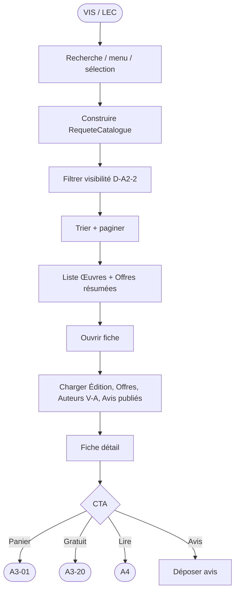
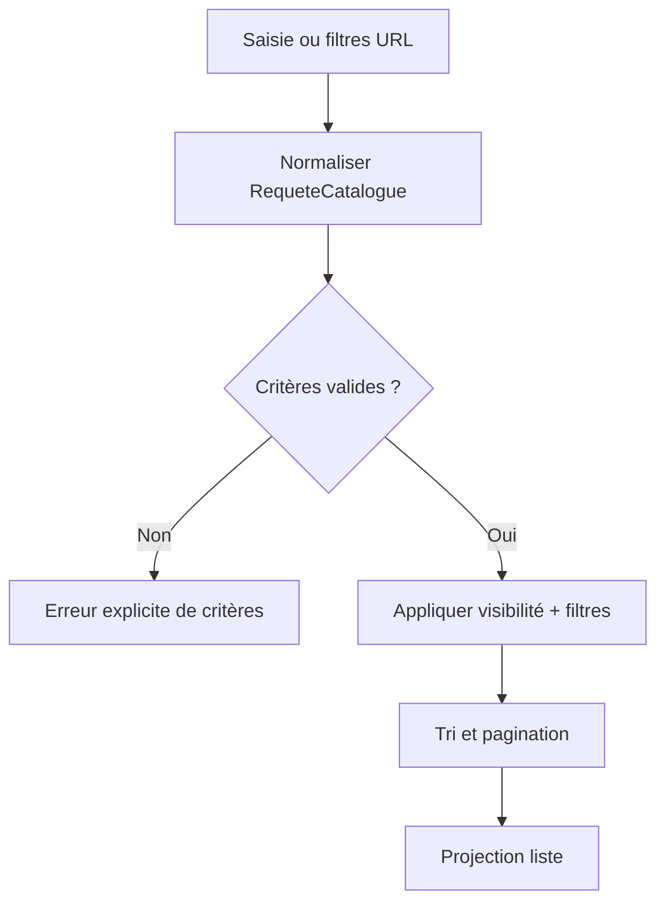
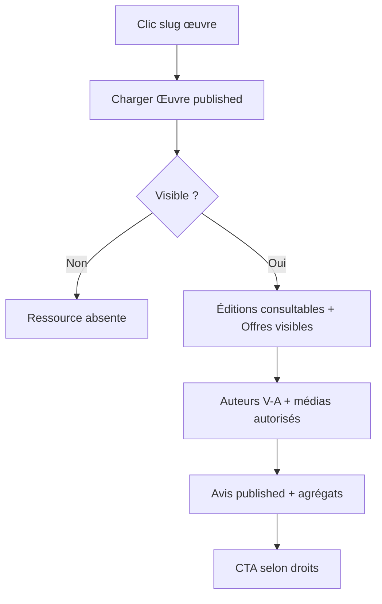
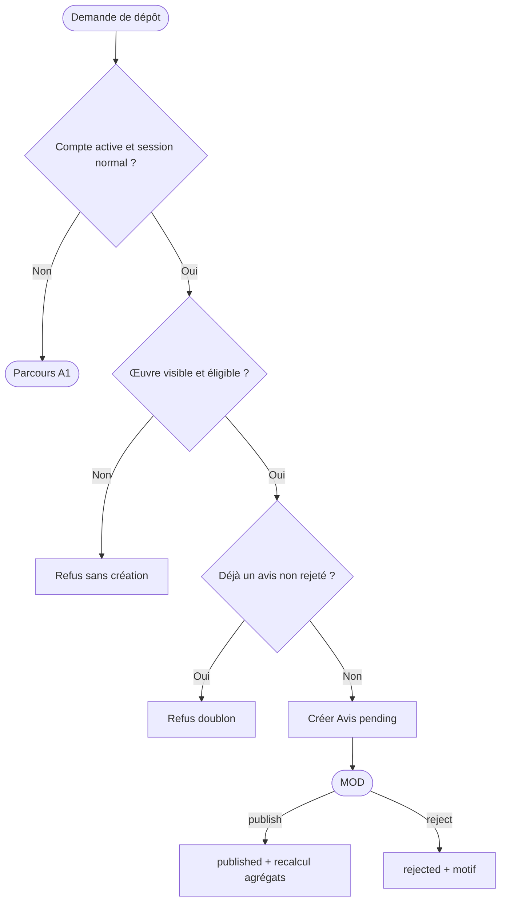

# MCT A2 — Découverte du catalogue (Afrique-Educ)

Version V1.2 — chaîne A2 — 6 septembre 2026.

**Statut : recommandations métier validées et intégrées (§11).** Les cinq arbitrages sont clos. Les règles, attributs, contraintes et traitements A2 intègrent ces décisions. Les contrats inter-chaînes restent à vérifier sur leurs documents sources ; les paramètres détaillés de location relèvent de A3/A4. Audit documentaire effectué sur les deux fichiers A2 fournis uniquement.

Document **limité à A2** et à ses interfaces. Les processus P13–P19, P16–P18, P17 et P21 (lecture + dépôt d’avis) sont détaillés. P20 / P23 restent hors V1 persistante.

Sources : [MCD A2](mcd_v1_A2_Decouverte_Catalogue.md), [MCT A1 corrigé](../A1/mct_v1_1_corrige_A1.md), [MCD A1 corrigé](../A1/mcd_v1_1_corrige_A1.md), `docs/processus_metiers.md`.

Convention : **événement → opération(s) → résultat / message**.  
Acteurs : VIS, LEC, MOD, SYS (voir inventaire processus).

---

## 1. Périmètre

| Chaîne | Processus | Résultat métier |
|--------|-----------|-----------------|
| A2 Découverte | P13, P14, P15, P16, P17, P18, P19, P21* | Offres et fiches consultables ; avis publiés |

\* P21 : lecture publique + dépôt (préconditions A1) ; modération MOD.

### Hors MCT A2 détaillé

Favoris persistants (P20), follow (P23), soumission catalogue éditeur (P24), panier/paiement (A3), lecture sécurisée (A4), publication (A5), signalement (A6 — sauf impact visibilité).

### Préconditions A1 (interfaces)

| Action A2 | Précondition |
|-----------|----------------|
| Consulter catalogue / fiches | Aucune (VIS) |
| Déposer un avis | Compte `active` + session `normal` |
| CTA « Obtenir gratuit » | Même précondition → message vers A3-20 |
| CTA « Lire » | Compte active + session normal + droit de lecture valide vérifié auprès de A4 pour le contenu/support demandé ; sinon parcours A1 ou achat/gratuit selon le cas |
| CTA « Ajouter au panier » | Aucune auth pour l’ajout (A3-01) ; paiement plus tard |

---

## 2. Décisions D-A2 appliquées aux traitements

| Décision | Effet MCT |
|----------|-----------|
| D-A2-1 | Toute liste / fiche matérialise des **Offres**, pas un prix d’œuvre unique. |
| D-A2-2 | Toutes les opérations publiques appliquent les prédicats du MCD §6 ; déduplication et visibilité avant tri/pagination. |
| D-A2-3 | Toutes les projections d’auteur appliquent V-A (published ET actif), y compris recherche et métadonnées. |
| D-A2-4 | Exception soon sans Offre visible selon D-A2-10 (§11) ; pas de CTA transactionnel ni de prix inventé. |
| D-A2-5 | Aperçu = MediaCatalogue uniquement. |
| D-A2-6 | Après publication/rejet d’avis, recalcul des agrégats Œuvre. |
| D-A2-7 | P13 passe par RequeteCatalogue / IndexCatalogue (spec logique). |
| D-A2-8 | P19 résout sélection par code (filtre ou liste manuelle, modes exclusifs). |
| D-A2-9 | Plusieurs vendeurs ; Offres achat/location distinctes ; identité, affichage et transmission de la modalité (§11). |
| D-A2-10 | Soon sans Offre : sélection À paraître et fiche directe uniquement ; aucune transaction (§11). |
| D-A2-11 | CDF/USD, USD initial ; comparaison dans la devise choisie, sans conversion (§11). |
| D-A2-12 | Tendances manuelle ; aucun tri popular en V1 (§11). |
| D-A2-13 | Avis sans preuve d’achat pour tout compte actif en session normale, avec modération et contrôle de l’œuvre (§11). |

---

## 3. Vue synoptique A2

---

## 4. Opérations A2

### 4.1 Recherche et filtrage — P13 / P14

| Op. | Événement / acteur | Conditions et traitement | Données | Résultat |
|-----|--------------------|---------------------------|---------|----------|
| A2-01 | Saisie barre / query search / VIS | Normaliser texte et bornes ; rechercher titre, nom Auteur V-A, ISBN Édition V-E, catégories actives. Les catégories sont identifiées par chemin ou identifiant, non par slug local seul. | RequeteCatalogue, IndexCatalogue ou sources métier | Critères validés ou erreur explicite ; aucun critère invalide ignoré silencieusement |
| A2-02 | Filtres catalogue / VIS | Appliquer les critères du MCD §6 : format, modalité achat/location, prix, devise, gratuité et état sur une même Offre V-F ; éditeur sur son Édition V-E ; devise selon D-A2-11 ; autres filtres sur Œuvre/référentiels actifs. Descendance active par chemin/id. | RequeteCatalogue et entités associées | Œuvres candidates avec Offres correspondantes |
| A2-03 | SYS | Appliquer V-W selon contexte D-A2-10 et les prédicats de chaque objet (MCD §6), y compris en présence d’un index/cache | Œuvre, Edition, Offre, Auteur | Ensemble publiable |
| A2-04 | Tri recent / price / ordre de sélection / VIS | Dédupliquer Œuvres ; calculer le prix de référence des Offres correspondantes dans la devise D-A2-11 ; trier de façon stable (MCD §6, popular refusé en V1 selon D-A2-12) ; paginer puis projeter carte avec auteurs V-A et médias autorisés | Œuvre, Offre, MediaCatalogue | Liste paginée |

**Règles**
- Devise de comparaison : USD initialement, CDF sur choix du lecteur ; aucune conversion automatique. Filtre/tri de prix : exclure les œuvres sans Offre correspondante dans cette devise. Hors recherche de prix, conserver les devises réelles affichées.
- Modalités achat et location, vendeurs et devises sont explicités sur les offres ; une carte ne fusionne pas leurs conditions. La comparaison du prix de location ne promet pas de comparer une durée identique tant que les formules A3/A4 ne sont pas définies.
- Une carte liste expose **plusieurs** prix/formats si plusieurs Offres visibles.
- Catégorie parente : inclure les œuvres des descendantes (paramètre configurable).
- Aucune fuite d’œuvres `draft` / auteurs `draft` / offres inactives.

### 4.2 Navigation catégories — P18

| Op. | Événement | Traitement | Résultat |
|-----|-----------|------------|----------|
| A2-10 | Ouverture mega menu / page catégorie | Charger arbre Categorie `actif` ordonné | Menu / page |
| A2-11 | Clic nœud | Résoudre chemin/id actif ; construire RequeteCatalogue.categories = [nœud ± descendance active] puis A2-02…04 | Liste filtrée |

### 4.3 Découverte éditoriale — P19

| Op. | Événement | Traitement | Résultat |
|-----|-----------|------------|----------|
| A2-15 | Entrée nouveautés / tendances / gratuits / rares / africains / audio / scolaire… | Résoudre `SelectionEditoriale` par code : exiger sélection active ; appliquer soit filtre paramétré soit SelectionOeuvre ordonné, jamais les deux ; puis A2-03…04. Tendances : mode manuelle uniquement, ordre des lignes ; À paraître : code a_paraitre et filtre soon, seule sélection autorisant les œuvres sans Offre V-F | Liste curated |
| A2-16 | MOD met à jour vitrine | Vérifier habilitation MOD ; modifier badge éditorial, mis_en_avant ou sélection selon son mode ; jamais écrire un badge gratuit indépendant ; déclencher A2-50 | Vitrine à jour |

Pilotage détaillé MOD peut croiser P100 ; A2-16 en est l’interface découverte.

### 4.4 Fiche œuvre — P15

| Op. | Événement | Traitement | Données | Résultat |
|-----|-----------|------------|---------|----------|
| A2-20 | Accès `/livres/{slug}` | Résoudre slug ; contrôler V-W et contexte D-A2-10 avant toute projection | Œuvre | Fiche ou 404 indifférencié |
| A2-21 | Fiche OK | Charger Éditions V-E et Offres V-F + Formats actifs ; ne pas exposer MediaPrive | Edition, Offre, FormatTechnique, MediaCatalogue | Bloc formats / prix |
| A2-22 | Fiche OK | Charger co-auteurs V-A et références actives : éditeur de chaque Édition, catégories, langues, collection, niveau | Auteur, Editeur, … | Métadonnées |
| A2-23 | Fiche OK | Lister Avis `published` (pagination) ; afficher note_moyenne / avis_count | Avis, Œuvre | Bloc avis |
| A2-24 | Fiche OK / LEC optionnel | Exiger Compte active et session normal ; demander à A4 le droit effectif pour le contenu/support sélectionné. Le rattachement de LicenceContenu (Œuvre/Édition/Offre) reste à confirmer : ne pas présumer une licence par Offre | LicenceContenu | CTA « Lire » ou offres « Acheter » / « Louer » selon droits et modalités |
| A2-25 | Aperçu demandé | Recontrôler fiche/cible et média autorisés ; servir uniquement le dérivé public plafonné du MCD §3.4, jamais le fichier intégral masqué côté client | MediaCatalogue | Aperçu |
| A2-26 | CTA panier | Recontrôler Offre V-F et éligibilité transactionnelle ; émettre demande vers A3-01. A3 revalide prix, stock, modalité et décide | Offre.id, quantité, modalite_commerciale (achat/location), devise de l’Offre, contexte de corrélation | Demande transmise ; A3 confirme ajout ou refuse |

Pour une Œuvre soon sans Offre V-F, A2-20 autorise la fiche directe, A2-21 ne fournit aucun prix et les actions transactionnelles A2-26/A2-27 sont refusées côté traitement, pas seulement masquées. A2-41 refuse le dépôt d’avis. Les œuvres de ce type sont exclues des recherches générales, catégories et bibliographies.

**404** — Même réponse pour slug inconnu, draft, retiré ou archivé (pas d’énumération).

### 4.5 Fiche auteur — P16

| Op. | Événement | Traitement | Résultat |
|-----|-----------|------------|----------|
| A2-30 | Accès fiche auteur | Exiger Auteur `published` ∧ `actif` | Fiche ou 404 |
| A2-31 | Fiche OK | Bibliographie = Œuvres V-W liées via OeuvreAuteur ; déduplication, tri stable et pagination | Liste œuvres |
| A2-32 | Fiche OK | Afficher tags, bio, pays, verified / mis_en_avant | Profil public |
| A2-33 | Ouverture annuaire auteurs | Filtrer V-A et critères publics/tag ; trier et paginer | Annuaire public |

Pas de stats ventes sensibles en V1 publique (espace auteur = A5/A1).

### 4.6 Fiche éditeur / maison — P17

| Op. | Événement | Traitement | Résultat |
|-----|-----------|------------|----------|
| A2-35 | Accès fiche éditeur | Exiger Editeur `actif` | Fiche ou 404 |
| A2-36 | Fiche OK | Deux ensembles identifiés : Éditions V-E de cet éditeur, et Collections actives portées par lui ; Œuvres V-W dans les deux cas. Dédupliquer, trier et paginer chaque ensemble (MCD §6) | Liste œuvres |
| A2-37 | Fiche OK | Afficher type publisher/house, présentation, flags | Profil maison |

### 4.7 Avis lecteurs — P21

| Op. | Événement / acteur | Traitement | Données | Résultat |
|-----|--------------------|------------|---------|----------|
| A2-40 | Lecture avis / VIS | Contrôler Œuvre V-W ; lister published avec pagination | Avis | Liste |
| A2-41 | Soumission / LEC | Vérifier Compte active + session normal ; Œuvre V-W ; sans preuve d’achat/location ; refuser soon sans Offre V-F (D-A2-13) ; note 1–5 et corps borné ; assurer atomiquement au plus un avis non rejeté puis créer pending | Compte, SessionAuthentification, Avis | Avis en modération |
| A2-42 | Décision / MOD | Vérifier habilitation MOD et état pending ; publier ou rejeter ; enregistrer modérateur, date et motif obligatoire pour rejet. Aucune republication directe d’un rejected | Avis, Compte modérateur | Décision enregistrée ; événement A2-43 |
| A2-43 | Après publish/reject ou retrait / SYS | Recalculer à partir des seuls Avis published ; aucun avis : note_moyenne nulle et avis_count = 0. Recalcul idempotent et reprise sur échec | Avis, Œuvre | Agrégats cohérents |
| A2-44 | Retrait d’un avis publié / MOD ou décision A6 | Vérifier habilitation ; published → rejected avec motif et modérateur ; conserver l’avis et la dernière décision motivée, déclencher A2-43 | Avis | Avis exclu immédiatement ; nouvel avis ultérieur soumis à D-A2-13 et à l’unicité |

**Règle** — Un compte `pending` / `suspended` / `closed` ou session non `normal` ne peut pas déposer d’avis.

---

## 5. Messages / synchronisations

| Message | Émetteur | Récepteur |
|---------|----------|-----------|
| Demande d’ajout au panier (Offre, quantité, modalité/contexte) | A2-26 | A3-01 ; confirmation ou refus par A3 |
| Demande gratuit | A2-27 | A3-20 (préconditions A1) |
| Demande lecture | A2-28 | A4-01… (si licence) sinon A3 |
| Œuvre / Offre publiée | A5-04 | IndexCatalogue + listes A2 |
| Contenu retiré | A6 | Exclusion A2-03 ; 404 A2-20 |
| Auteur passé published ou changement actif | A5 / MOD | A2-50 ; annuaire A2-33 et fiche A2-30 selon V-A |
| Auteur reste `draft` | A1-08 | Invisible A2 |
| Avis publié / rejeté / retiré | A2-42 / A2-44 | A2-43 agrégats |
| Compte suspendu | A1-22 | Blocage A2-41 |

---

## 6. Transitions d’objets visibles A2

| Objet | Transition | Condition |
|-------|------------|-----------|
| Œuvre | draft → published | A5 validation ; indexation |
| Œuvre | published → archived / retirée | MOD / A6 |
| Offre | création → actif | Publication ; prix ≥ 0, devise CDF/USD, modalité achat/location et vendeur renseignés ; conditions de location validées par A3/A4 avant activation |
| Offre | actif → inactif / retirée | Vendeur, stock, A6 |
| Auteur | draft → published | Publication fiche (pas A1-08 seul) |
| Avis | pending → published \| rejected ; published → rejected | Décision MOD tracée ; A2-42/A2-44 puis A2-43. rejected ne repasse pas directement à published. |
| SelectionEditoriale | — | Activation / désactivation MOD |

---

## 7. Matrice processus ↔ opérations

| ID | Dans MCT A2 ? | Opérations |
|----|---------------|------------|
| P13 | Oui | A2-01, A2-03, A2-04 |
| P14 | Oui | A2-02…04 |
| P15 | Oui | A2-20…28 |
| P16 | Oui | A2-30…33 |
| P17 | Oui | A2-35…37 |
| P18 | Oui | A2-10…11 |
| P19 | Oui | A2-15…16 |
| P21 | Oui (léger) | A2-40…44 |
| P20, P23, P24 | Non | Stubs MCD |
| A3 / A4 / A5 / A6 | Interfaces | Messages §5 |

---

## 8. Critères de recette A2

Ces cases sont des scénarios à implémenter et exécuter ; elles ne sont pas des résultats de tests.

- [ ] VIS voit uniquement Œuvres V-W ; exception soon strictement conforme à D-A2-10, sans CTA transactionnel.
- [ ] Carte liste et fiche affichent **plusieurs** formats/prix ; jamais un seul prix inventé au niveau œuvre.
- [ ] Recherche titre / auteur publié / ISBN renvoie des résultats cohérents ; auteur `draft` absent.
- [ ] Filtres format, langue, gratuit, catégorie (avec enfants), tri et pagination fonctionnent.
- [ ] Sélections P19 (nouveautés, gratuits, etc.) respectent le code SelectionEditoriale.
- [ ] Fiche œuvre inconnue, draft ou retirée → 404 identique.
- [ ] Aperçu ne délivre pas MediaPrive.
- [ ] Fiche auteur / éditeur : bibliographie limitée aux œuvres visibles.
- [ ] LEC session `normal` peut déposer un avis ; doublon refusé ; VIS redirigé vers auth.
- [ ] Après publish d’avis, agrégats Œuvre mis à jour ; avis `pending` invisibles au public.
- [ ] CTA panier émet vers A3 ; CTA lire respecte licence ; CTA gratuit exige A1.

---

## 9. Règles transverses

1. **Œuvre ≠ Offre** — panier et prix portent sur une Offre.  
2. **Découverte ≠ lecture** — pas de fichier intégral.  
3. **Visibilité avant pagination** — ne pas paginer puis filtrer.  
4. **Pas d’énumération** — 404 uniforme.  
5. **Alignement A1** — avis et CTA sensibles = compte `active` + session `normal`.  
6. **Alignement A5/A6** — publication et retrait pilotent l’index et les listes.

---

## 10. Suite

1. Décisions D-A2-9 à D-A2-13 intégrées ; utiliser cette version pour le MLD/MOT A2 et vérifier les contrats inter-chaînes.  
2. MLD A2 (éditions, langues, avis, sélections) en continuité du lot 1.  
3. Remplacer le §4 sommaire du MCT A1 global par un renvoi vers ce document lors d’une prochaine consolidation.

## 10 bis. Synchronisation, interfaces et préparation du MOT

| Opération | Déclencheur | Traitement et résultat |
|-----------|-------------|-----------------------|
| A2-27 | CTA gratuit | Compte active + session normal, Offre V-F à prix nul et éligible ; demander A3-20 avec Offre.id, modalite_commerciale, devise et contexte ; la location gratuite ne vaut pas acquisition définitive. A3 revalide l’éligibilité et retourne succès/refus ; aucun octroi par A2. |
| A2-28 | CTA lire | Préconditions A1 puis vérification A4 du droit pour le contenu/support demandé ; transmettre la demande, A4 recontrôle avant d’ouvrir la lecture. Aucun lien MediaPrive en réponse A2. |
| A2-50 | Publication, retrait, changement de prix/stock/statut/métadonnées, référentiel, média ou sélection | Invalider les projections concernées et synchroniser index/cache de façon idempotente, avec reprise. Recontrôle des prédicats métier à la diffusion ; aucune fenêtre autorisant un contenu retiré. |

Les opérations A2-27/28 complètent P15 ; A2-50 est transverse. Un manque de stock peut interdire l’achat sans nécessairement cacher la fiche : disponibilité transactionnelle revalidée par A3 ; aucun automatisme « stock nul = retrait de contenu » n’est imposé par A2.

**Contrats à vérifier sur les modèles sources, non joints** : identité Compte/Auteur et droits MOD (A1), identité commerciale et disponibilité d’Offre (A3, D-A2-9), cible et portée du droit LicenceContenu (A4), conditions de publication progressive (A5), retrait par Œuvre/Édition/Offre/média/avis (A6). Les numéros A1/A3/A4/A5 cités sont hérités et ne constituent pas une certification de ces interfaces.

**Organisation à détailler dans le MOT** : LEC dépose via la fiche ; MOD traite une file d’avis et pilote la vitrine dans un espace habilité ; SYS traite synchronisations et agrégats. Les délais, personnes affectées et fréquences sont des paramètres d’exploitation à préciser, pas des horaires inventés. Les retraits et contrôles de droits s’appliquent immédiatement ; les projections peuvent être asynchrones à condition de respecter cette garantie. Les erreurs de synchronisation restent détectables et rejouables.

**Recette complémentaire (scénarios non exécutés)**
- [ ] Deux vendeurs peuvent proposer la même édition/format/état ; leurs Offres restent distinctes.
- [ ] Achat et location coexistent sans confusion de prix, vendeur, devise ou droit accordé.
- [ ] USD sélectionné initialement ; passage à CDF sans conversion ; absence de prix correspondant exclut du tri de prix.
- [ ] À paraître sans Offre : sélection dédiée et fiche directe accessibles ; recherche générale, catégories et bibliographies excluent l’œuvre.
- [ ] Tendances respecte l’ordre manuel ; popular retourne une erreur de tri non autorisé.
- [ ] Compte actif sans achat peut déposer un avis sur une œuvre éligible ; modération préalable conservée.
- [ ] Brouillon créé sans Édition/Offre ; exigences de publication contrôlées séparément.
- [ ] Auteur publié mais inactif absent de toutes les projections publiques.
- [ ] « PDF + gratuit » ne retient pas une Œuvre dont seul l’EPUB est gratuit.
- [ ] Plusieurs Offres correspondantes ne dupliquent pas une Œuvre en pagination.
- [ ] Deux catégories homonymes sous des parents différents sont résolues sans ambiguïté.
- [ ] Recherche par ISBN d’Édition cachée ne révèle pas celle-ci.
- [ ] Prix et tri respectent D-A2-11 ; aucune comparaison brute de devises différentes.
- [ ] Index obsolète après retrait : contenu et aperçu restent inaccessibles.
- [ ] Rejet motivé conservé ; retrait d’un avis publié recalcule la note ; concurrence de dépôt sans doublon.
- [ ] Carte bientôt et droit de déposer un avis conformes aux décisions D-A2-10/D-A2-13.
- [ ] Absence de licence vérifiée : aucun CTA Lire autorisé ; A4 décide à l’ouverture.

## 11. Décisions métier validées — communes au MCD et au MCT

Les cinq recommandations ont été approuvées explicitement par le propriétaire du projet le 6 septembre 2026. Les anciens arbitrages Q1–Q5 sont clos et deviennent D-A2-9 à D-A2-13. Les variantes non retenues sont supprimées.

| Décision | Origine | Règle validée | Application |
|----------|---------|---------------|-------------|
| D-A2-9 | Q1 | Plusieurs vendeurs peuvent proposer une même édition/format/état. Achat et location sont des modalités distinctes d’Offre. | Vendeur et modalite_commerciale participent à l’identité commerciale ; chaque offre affiche son vendeur, sa modalité et sa devise. Les paramètres détaillés de location sont à spécifier avec A3/A4, sans durée ou tarif inventé. |
| D-A2-10 | Q2 | Une Œuvre soon sans Offre visible apparaît uniquement dans la sélection « À paraître » et sur sa fiche directe. | Exclue de recherche générale, catégories, autres sélections et bibliographies ; aucun CTA d’achat, location, obtention gratuite ou précommande. Pas de prix inventé. |
| D-A2-11 | Q3 | Devises CDF et USD ; USD sélectionné initialement, changement possible par le lecteur ; aucune conversion automatique. | Filtre ou tri de prix : seules les Offres dans la devise choisie participent. Sans offre correspondante, exclure l’Œuvre de cette recherche de prix. Hors filtre/tri de prix, afficher les prix dans leur devise réelle. |
| D-A2-12 | Q4 | « Tendances » est une sélection manuelle en V1, pilotée par MOD. | Ordre par SelectionOeuvre.sort_order puis identifiant. Aucun tri popular ni indicateur de popularité calculé en V1. |
| D-A2-13 | Q5 | Tout compte active avec session normal peut déposer un avis, sans preuve d’achat/location, avec modération préalable. | Œuvre visible et non soon sans Offre visible ; au plus un avis non rejeté par compte/œuvre. Nouvelle soumission possible après rejet. |

### Suite de conception
1. Utiliser ces décisions dans le MLD et le MOT A2 ; aucun arbitrage Q1–Q5 n’est en attente.
2. Vérifier les interfaces sur les documents A1/A3/A4/A5/A6 : identité et droits, paramètres de location, portée des licences et publication/retrait. Cette vérification ne remet pas en attente les décisions validées ci-dessus.
3. Les scénarios de recette décrits restent à implémenter et exécuter ; la présente révision vérifie les documents, pas le code applicatif.
